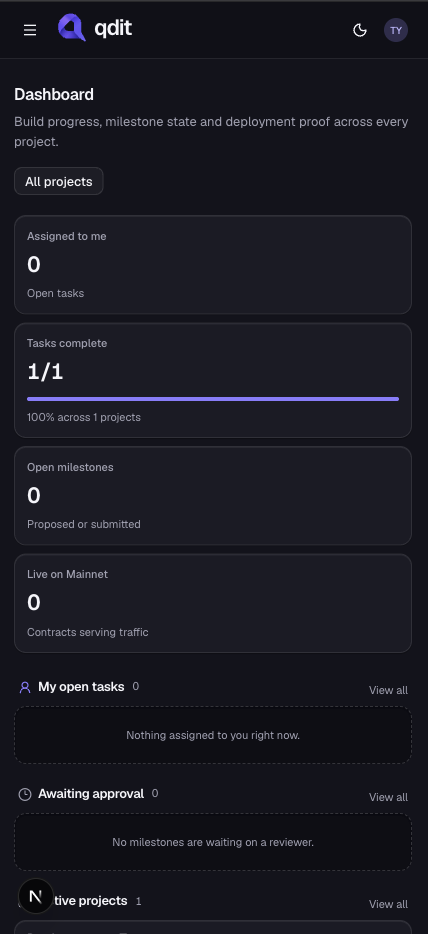
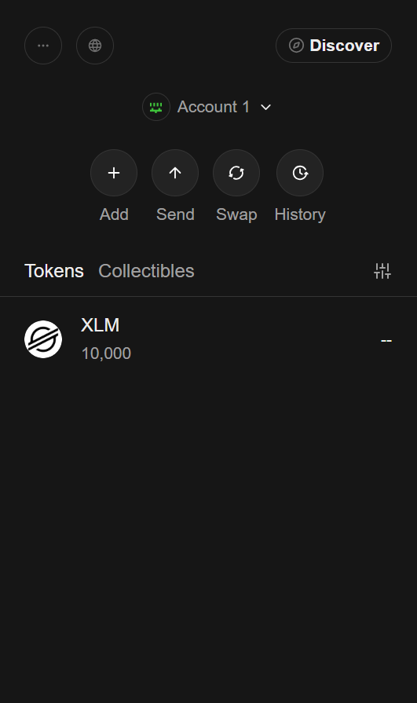
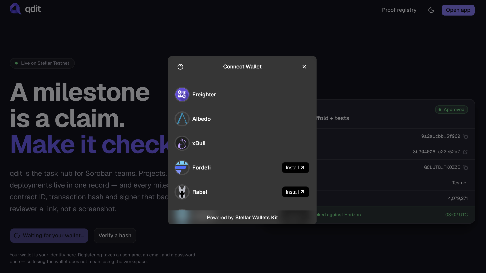
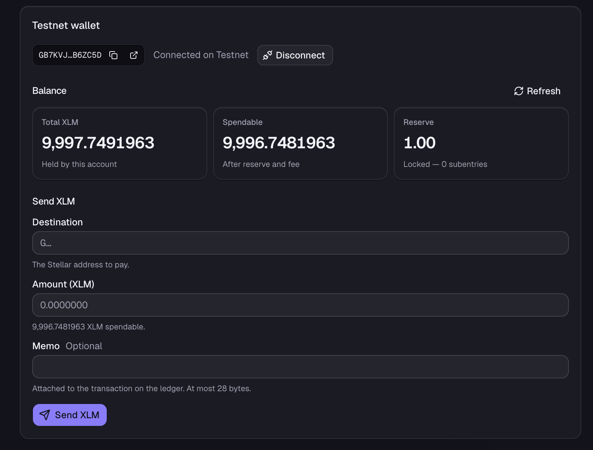
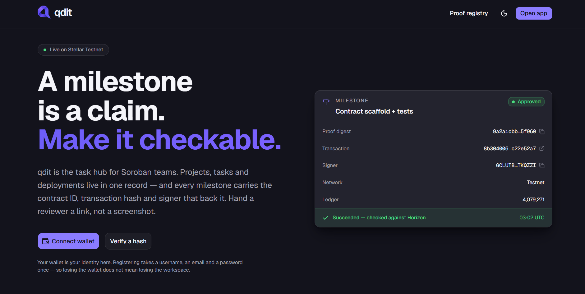
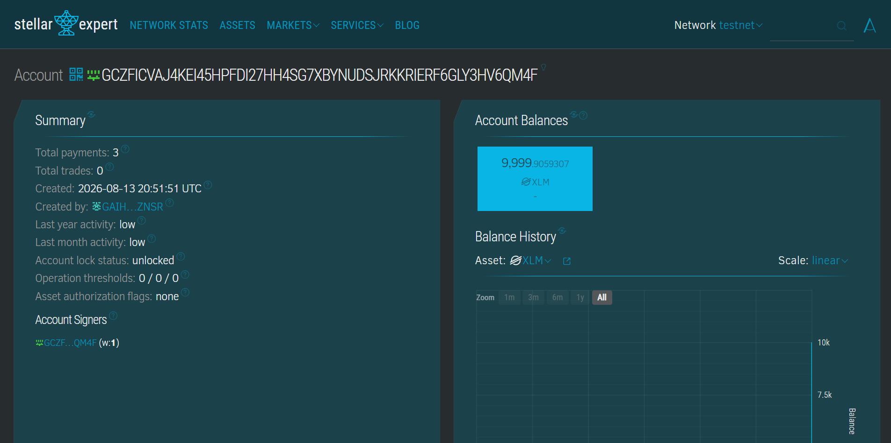
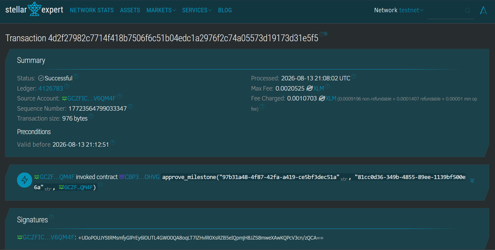
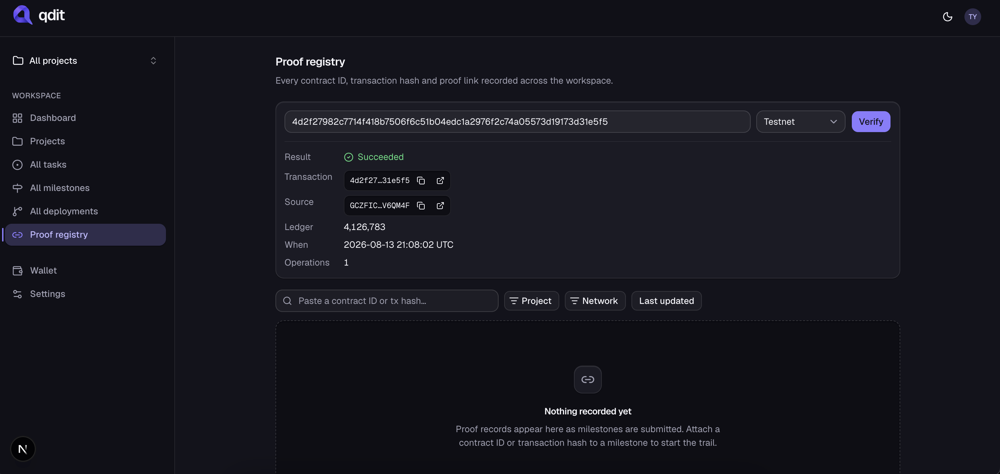
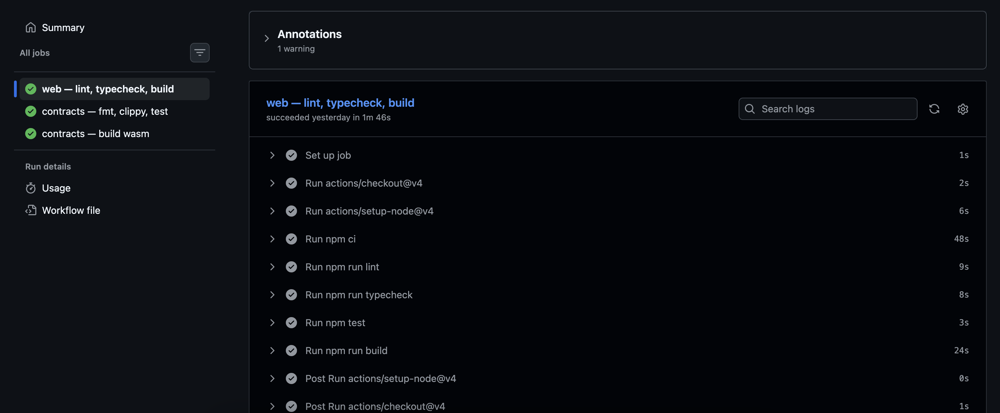
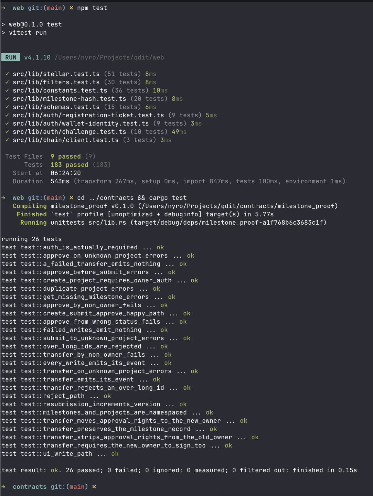

<p align="center">
  
</p>

<h1 align="center">qdit</h1>

<p align="center">
  <strong>Builder operations → milestone approvals → on-chain proof</strong>
</p>

<p align="center">
  Run projects, tasks, milestones and deployments in one hub, then anchor every
  milestone's proof hash on <a href="https://stellar.org">Stellar</a> so “approved vs
  actually shipped” is ledger-true.
</p>

<p align="center">
  <a href="https://qdit.atalusan.com"></a>
  <a href="https://drive.google.com/file/d/1HBxmheFjpR25ik5xgWOF2vvOb32JEDIf/view?usp=sharing"></a>
  <a href="https://x.com/tyrontalusan/status/2090972526537212390"></a>
  <a href="https://qdit.atalusan.com/user-guide"></a>
  <a href="https://qdit.atalusan.com/docs"></a>
  <a href="https://docs.google.com/presentation/d/1WNYg2brDl0bo-e9BkYXfPY9PjTfNUpK-TKeA31Zbid4/edit?usp=sharing"></a>
  <a href="https://docs.google.com/spreadsheets/d/1b3Sor1gr-LkVshQ69jSiRjPMWOejfwt9uE3vdGPjVtc/edit?usp=sharing"></a>
  <a href="https://docs.google.com/spreadsheets/d/1h1eIa4kQK8pjmgnNR30P9ZLOy4UXONTWf2bPQOnSVCc/edit?usp=sharing"></a>
  <a href="https://docs.google.com/spreadsheets/d/1dDzm2ZqA2hROPp0Pzd1iX9gffqs0nYsQ1euOW40rT-A/edit?usp=sharing"></a>
</p>

<p align="center">
  <a href="https://stellar.expert/explorer/public/contract/CBJHS2ZGKYJJUQR6YNSMZYGDPVHEESKGONN7IEOUMBDWAMUYAVIOOZRD"></a>
  <a href="https://stellar.expert/explorer/testnet/contract/CBP3NKXCRUSOJLLUXDF5AIRNPAC6IL7TFJ2KCNL5A2GTKC2MB7M4OHVG"></a>
</p>

<p align="center">
  <a href="https://qdit.atalusan.com">Live demo</a> ·
  <a href="https://drive.google.com/file/d/1HBxmheFjpR25ik5xgWOF2vvOb32JEDIf/view?usp=sharing">Demo video</a> ·
  <a href="https://x.com/tyrontalusan/status/2090972526537212390">Video on X</a> ·
  <a href="https://qdit.atalusan.com/user-guide">User guide</a> ·
  <a href="https://qdit.atalusan.com/docs">Technical docs</a> ·
  <a href="https://docs.google.com/presentation/d/1WNYg2brDl0bo-e9BkYXfPY9PjTfNUpK-TKeA31Zbid4/edit?usp=sharing">Pitch deck</a> ·
  <a href="https://docs.google.com/spreadsheets/d/1b3Sor1gr-LkVshQ69jSiRjPMWOejfwt9uE3vdGPjVtc/edit?usp=sharing">Mainnet responses (round 2)</a> ·
  <a href="https://docs.google.com/spreadsheets/d/1h1eIa4kQK8pjmgnNR30P9ZLOy4UXONTWf2bPQOnSVCc/edit?usp=sharing">Mainnet responses (round 1)</a> ·
  <a href="https://docs.google.com/spreadsheets/d/1dDzm2ZqA2hROPp0Pzd1iX9gffqs0nYsQ1euOW40rT-A/edit?usp=sharing">Testnet feedback responses</a> ·
  <a href="https://stellar.expert/explorer/public/contract/CBJHS2ZGKYJJUQR6YNSMZYGDPVHEESKGONN7IEOUMBDWAMUYAVIOOZRD">Mainnet contract on Stellar Expert</a> ·
  <a href="https://stellar.expert/explorer/testnet/contract/CBP3NKXCRUSOJLLUXDF5AIRNPAC6IL7TFJ2KCNL5A2GTKC2MB7M4OHVG">Testnet contract on Stellar Expert</a>
</p>

<p align="center">
  
  
  
  
  
  
  
</p>

---

## Project status

> **Everything documented below is completed, self-funded prior work.** The v1
> `milestone_proof` contract, the web app, and the testnet and mainnet tester rounds were
> built and paid for by the team, and are not part of any pending funding request.
>
> **Next phase — planned, not started:** a new `milestone_proof` v2 contract on **Stellar
> testnet** with on-chain team roles and M-of-N milestone approval, Merkle batch anchoring
> with inclusion proofs, and `@qdit/verify` v0.1, a minimal open-source verifier (library +
> CLI). v1 stays deployed and unchanged; v2 is a separate deployment.

---

## Problem

Builder teams plan and track in Linear, Notion, Jira and a spreadsheet — then claim
delivery to a grant program, a client or a DAO.

That creates a trust gap:

- **“Done” is a database column.** Whoever owns the tracker can set it, unset it and
  backdate it, and nobody outside the workspace can tell.
- **Approval leaves no receipt.** A reviewer clicks approve; the evidence is a screenshot
  in a thread that outlives nothing.
- **Reporting is re-typed by hand.** The tracker, the grant report and the ledger are
  three separate stories about the same work.
- **Proof does not survive the team.** Vendor churn, a lapsed seat, a migrated workspace —
  the history goes with the tool.

In short: **project management has no independently verifiable record of what shipped.**

## Solution

**qdit** is a builder task hub — with Stellar as the proof layer.

| Layer | What it does |
| --- | --- |
| **Hub + board** | Projects, tasks, milestones, deployments and proofs, project-scoped by default |
| **Milestone state machine** | Each milestone tracks lifecycle: Proposed → Submitted → Approved \| Rejected |
| **Approval flow** | Approve/reject reserved to the project owner, enforced in Postgres *and* on chain |
| **milestone_proof (Soroban)** | Anchor SHA-256 milestone hashes on Stellar with owner auth |
| **Public receipt** | Proof digest, transaction hash, signer, network and ledger stay on screen and on the ledger — not in your database |

**Result:** every approved milestone leaves a hash anyone can verify against the ledger.
Approved vs shipped stops being a claim and becomes a fact.

## Vision

Most builder programs pay against milestones. Most milestones are attested by a
screenshot.

**qdit** closes the gap:

1. Run the real work — board, tasks, milestones, deployments — in one project-scoped hub.
2. Move a milestone through the contract's own state machine, so the database can never
   reach a state the chain refuses to reproduce.
3. Hash the milestone's state and anchor it on Soroban, signed by the builder's own wallet.
4. Publish the digest, not the data, so a reviewer can verify a milestone was in a given
   state at a given time without access to the workspace.

> Approved vs shipped becomes a receipt, not a marketing claim.

---

## Demo, deck and data

| Asset | Link |
| --- | --- |
| **Live app** — running on Stellar Testnet | [qdit.atalusan.com](https://qdit.atalusan.com) |
| **User guide** — step-by-step, in plain, simplified English | [Open the guide](https://qdit.atalusan.com/user-guide) |
| **Technical docs** — architecture, contract, data model, anchoring flow | [Open the docs](https://qdit.atalusan.com/docs) |
| **Demo video** — end-to-end walkthrough | [Watch on Google Drive](https://drive.google.com/file/d/1HBxmheFjpR25ik5xgWOF2vvOb32JEDIf/view?usp=sharing) |
| **Pitch deck** — 14 slides, problem → architecture → proof | [Open in Google Slides](https://docs.google.com/presentation/d/1WNYg2brDl0bo-e9BkYXfPY9PjTfNUpK-TKeA31Zbid4/edit?usp=sharing) |
| **User feedback** — 50 testnet responses, wallet · email · name · rating · free text | [Open in Google Sheets](https://docs.google.com/spreadsheets/d/1dDzm2ZqA2hROPp0Pzd1iX9gffqs0nYsQ1euOW40rT-A/edit?usp=sharing) |
| **Mainnet feedback, round 2** — 50 responses from the second production round | [Open in Google Sheets](https://docs.google.com/spreadsheets/d/1b3Sor1gr-LkVshQ69jSiRjPMWOejfwt9uE3vdGPjVtc/edit?usp=sharing) |
| **Mainnet feedback, round 1** — 20 responses from the first production round | [Open in Google Sheets](https://docs.google.com/spreadsheets/d/1h1eIa4kQK8pjmgnNR30P9ZLOy4UXONTWf2bPQOnSVCc/edit?usp=sharing) |
| **Mainnet product test, round 2** — 50 wallets · 50 projects · 150 transactions | [Jump to the tester table](#mainnet-product-test-round-2--50-wallets--150-transactions) |
| **Mainnet product test, round 1** — 20 wallets · 23 projects · 67 transactions | [Jump to the tester table](#mainnet-product-test--20-wallets--67-transactions) |
| **Testnet product test** — 50 testers · 119 milestones · 354 transactions | [Jump to the tester table](#testnet-product-test--50-testers--119-milestones--354-transactions) |
| **Live testnet transaction** — `approve_milestone`, ledger 4126783 | [View on Stellar Expert](https://stellar.expert/explorer/testnet/tx/4d2f27982c7714f418b7506f6c51b04edc1a2976f2c74a05573d19173d31e5f5) |
| **Deployed contract** — `milestone_proof`, 6 functions | [View on Stellar Expert](https://stellar.expert/explorer/testnet/contract/CBP3NKXCRUSOJLLUXDF5AIRNPAC6IL7TFJ2KCNL5A2GTKC2MB7M4OHVG) |

---

## Features

### On-chain registry (`contracts/`)

- **Milestone proofs** — SHA-256 hash per `(project_id, milestone_id)`, `version` increments on every re-submission
- **Approval lifecycle** — `Proposed → Submitted → Approved | Rejected`, approve/reject reserved to the project owner
- **Owner auth** — every write requires `require_auth()`; a transfer requires **both** the outgoing and incoming owner
- **Persistent storage + TTL** — ~30-day threshold, extended to ~90 days on every write
- **Events** — `(qdit, register|transfer|submit|approve|reject)` with **indexed `project_id` topic**

### App (`web/`)

- Project-scoped **board**: tasks, milestones, deployments, proofs, drag-and-drop, role-gated controls
- Supabase Auth via **wallet sign-in (SEP-10)** + 30 RLS policies over 8 tables
- **Anchoring** and **payments** built browser-side: prepare → wallet signs → server verifies and submits
- **Submission reliability** — the anchor path retries transient failures on a linear backoff under one wall-clock budget, bids inclusion-fee headroom so a wallet-signed envelope can't be rejected for underbidding mid-retry, and keeps the transaction hash on a timeout so a *pending* submit is reconciled later instead of lost
- **Take-away proof** — anchor history as a per-project **CSV**, and a self-contained **certificate per milestone** that verifies standalone against the ledger with this app offline (`/api/export/anchors`, `/api/export/certificate`)
- **Public proof page** — a milestone anyone can open with no account; names the active network (testnet is labelled, not inferred) and states plainly what the ledger proves and what it does not
- `/wallet` — connect, disconnect, XLM balance from Horizon, send a Testnet payment
- Typed URL filter state, so a filtered view is shareable and survives a refresh

**Responsive down to phone width.** Below `lg` (1024px) the sidebar becomes a sheet behind
a menu button and every panel stacks to one column. List rows shed optional columns using
**container** queries rather than viewport breakpoints, because the same row renders
full-width on `/tasks` and inside a half-width dashboard panel:



### Data layer (`supabase/`)

- 11 plain-SQL migrations, 8 tables, 7 enums, triggers, indexes, 30 RLS policies
- `queries.ts` is the only read path; every function returns `Page<T>` so no view renders an unbounded list by accident
- `actions.ts` re-validates with the same zod schema the client used and returns `{ ok, error, fieldErrors }` instead of throwing

---

## Deployed contracts

The app now runs against both **mainnet** and **testnet**. The contract carries no admin
address and no `upgrade` entry point on either network — that decision stayed closed even
for the mainnet deploy, so a bug means shipping a new contract id and migrating the
`chain_contract_id` the app stores per project, not an in-place upgrade.

### Stellar Mainnet — production

The mainnet deployment both production rounds ran against, on real fees — the
[first](#mainnet-feedback--first-production-round) with 20 testers, the
[second](#mainnet-feedback--second-production-round) with 50.

| Field | Value |
| --- | --- |
| **Network** | Stellar Mainnet (`Public Global Stellar Network ; September 2015`) |
| **Contract ID** | [`CBJHS2ZGKYJJUQR6YNSMZYGDPVHEESKGONN7IEOUMBDWAMUYAVIOOZRD`](https://stellar.expert/explorer/public/contract/CBJHS2ZGKYJJUQR6YNSMZYGDPVHEESKGONN7IEOUMBDWAMUYAVIOOZRD) |
| **CLI alias** | `milestone_proof` |
| **WASM hash** | `d4bbe221cbe9837cf277448d0fe3aa99cf0dd9213a98db15b671a34dadf2a8b4` |
| **Deploy transaction** | [`3a5242e6ffa6777b960f7800d1a8a9f709d1dba6fa0cbab558e8b070aa5a923b`](https://stellar.expert/explorer/public/tx/3a5242e6ffa6777b960f7800d1a8a9f709d1dba6fa0cbab558e8b070aa5a923b) |
| **Deployed** | 2026-08-21 11:07:10 UTC |

**Explorer links**

- [Contract on Stellar Expert](https://stellar.expert/explorer/public/contract/CBJHS2ZGKYJJUQR6YNSMZYGDPVHEESKGONN7IEOUMBDWAMUYAVIOOZRD)
- [Deploy transaction (Expert)](https://stellar.expert/explorer/public/tx/3a5242e6ffa6777b960f7800d1a8a9f709d1dba6fa0cbab558e8b070aa5a923b)
- [WASM upload transaction (Expert)](https://stellar.expert/explorer/public/tx/ed14a71d5bf81007e44bddcb7d9064e44936e7c8580820cc0d01b7011f9d68a8)

The **WASM hash is byte-identical to the [testnet deployment](#stellar-testnet--sandbox)**
below — the same reproducible build is live on both networks, so `stellar contract build`
against this source yields the hash deployed to mainnet and testnet alike.

### Stellar Testnet — sandbox

| Field | Value |
| --- | --- |
| **Network** | Stellar Testnet (`Test SDF Network ; September 2015`) |
| **Contract ID** | [`CBP3NKXCRUSOJLLUXDF5AIRNPAC6IL7TFJ2KCNL5A2GTKC2MB7M4OHVG`](https://stellar.expert/explorer/testnet/contract/CBP3NKXCRUSOJLLUXDF5AIRNPAC6IL7TFJ2KCNL5A2GTKC2MB7M4OHVG) |
| **CLI alias** | `milestone_proof` |
| **WASM hash** | `d4bbe221cbe9837cf277448d0fe3aa99cf0dd9213a98db15b671a34dadf2a8b4` |
| **Size** | 10777 bytes optimized (11899 unoptimized) · 6 exported functions |

**Explorer links**

- [Contract on Stellar Expert](https://stellar.expert/explorer/testnet/contract/CBP3NKXCRUSOJLLUXDF5AIRNPAC6IL7TFJ2KCNL5A2GTKC2MB7M4OHVG)
- [Deploy transaction (Expert)](https://stellar.expert/explorer/testnet/tx/afcf108fc640fac527e474f9593c050712a9b860ea5351bc43951f465d780ddb)
- [WASM upload transaction (Expert)](https://stellar.expert/explorer/testnet/tx/1d1483f02b3e2233cb60d67ac4ad1e0fe57b96b5fa43d71867daf5c5d7d92cf6)

The **WASM hash is the point of that table**: anyone can rebuild this source with
`stellar contract build` and check the hash matches what is deployed. If it does not,
the deployed bytes are not this code.

Deployment is **not** upgradable — no admin address, no `upgrade` entry point, by choice.
A bug means deploying a new contract id and migrating the `chain_contract_id` the app
stores per project. That migration is near-free while `projects.chain_contract_id` is null
everywhere and `milestone_anchors` is empty, and grows with every registered project.

### Verified live on this deployment

Beyond the 26 contract unit tests, checked against the deployed contract itself:

- `create_project_ref` emits its event and sets the owner.
- `transfer_project_owner` **cannot be assembled without the incoming owner's signature** —
  the CLI refuses with `Missing signing key for account G…`. That is the two-signature rule
  holding in production, not just in `mock_auths`.
- After a transfer, the previous owner gets `Error(Contract, #4)` `NotAuthorized` on the
  same project, so rights genuinely move rather than being shared.

> A caution learned while checking this: `stellar contract invoke` silently signs **every**
> auth entry it holds a local key for. A transfer between two identities that are both in
> your keystore therefore looks like it needed one signature. It did not — use an address
> you hold no key for to see the requirement.

### Mainnet product test — 20 wallets · 67 transactions

Twenty testers ran the live app against the mainnet contract
[`CBJHS2ZGKYJJUQR6YNSMZYGDPVHEESKGONN7IEOUMBDWAMUYAVIOOZRD`](https://stellar.expert/explorer/public/contract/CBJHS2ZGKYJJUQR6YNSMZYGDPVHEESKGONN7IEOUMBDWAMUYAVIOOZRD)
on **21 August 2026**, paying real fees. Every wallet, transaction and proof below is real
mainnet activity — each link opens on Stellar Expert.

| Contract call | Transactions |
| --- | -: |
| `create_project_ref` | 23 |
| `submit_milestone_proof` | 22 |
| `approve_milestone` | 22 |
| `reject_milestone` | 0 |
| **Total** | **67** |

That total is corroborated independently of this repo: the contract has emitted **67 events**,
one per write, matching the 67 transactions above.

Milestone outcomes: **22 submitted, all 22 approved, none rejected**, across 23 registered
projects. **No transaction failed on the ledger.** The retry pain the
[feedback round](#mainnet-feedback--first-production-round) describes was entirely
client-side — submissions that timed out before the transaction confirmed, then landed on a
retry — so every write that reached the chain succeeded. The one exception is the round's
1★: **Nadia Concepcion's project registered, but her submit and approve never reached the
ledger** — one transaction, no milestone anchored, exactly the "nothing went through" she
reported.

#### Testers

**Projects** counts `create_project_ref` calls; **Approved** is approved / submitted
milestones; **Anchor txs** counts the `submit` / `approve` / `reject` transactions on top of
the register txs.

| # | Tester | Rating | Wallet | Projects | Approved | Anchor txs | Register tx | Latest proof |
| -: | --- | :-: | --- | -: | -: | -: | --- | --- |
| 1 | Eduardo Villaraza | ★★★★★ | [View wallet](https://stellar.expert/explorer/public/account/GAQRL7NAKESPASHRCT3RSQBMFCMI7EA6W4BBT7CNZRT4TIQB22XSCS6Y) | 3 | 3/3 | 6 | [View](https://stellar.expert/explorer/public/tx/b8c7992a756f31e1ad63014bbc2fe8ebecadadbab410ee895a840e4be1ef7240) | [View](https://stellar.expert/explorer/public/tx/fcf744aaae932b80701989790700b6ae2ec9bb8dc7be850ad1141d51c4d04d01) |
| 2 | Cristina Sison | ★★★★★ | [View wallet](https://stellar.expert/explorer/public/account/GAG2AFHTCRTGSQDP55QBLMQZHWEZDWS3P4VMJCOB3VEUY4EQNL6GPLA4) | 2 | 2/2 | 4 | [View](https://stellar.expert/explorer/public/tx/790f183c03be017ba33bf58b6e222295df1bbba36fc0667d048b397cb56d3983) | [View](https://stellar.expert/explorer/public/tx/65c155387f64b27798eda31af6cdf6837624bf36235af357809d6b2ef5f8a234) |
| 3 | Noel Panganiban | ★★★★★ | [View wallet](https://stellar.expert/explorer/public/account/GD4XCJJTYD3AYYKR5H6JTOFVQPQVL5DBJPRUOWYMWMVYUGRXTLTSAX5N) | 1 | 1/1 | 2 | [View](https://stellar.expert/explorer/public/tx/1e270ef281c6bbd25955af0c4595a31cf875a9be0be9cab4c9784cd9c63b4c2d) | [View](https://stellar.expert/explorer/public/tx/557dbcd8658c489e59858e586644f6bf0a93183afb3ee6c3777b25d05b3cdee6) |
| 4 | Grace Abella | ★★★★★ | [View wallet](https://stellar.expert/explorer/public/account/GD2TXUDRM45MC2STWI5M3SV3MA22OGA2QN6QBMJXD44HWU6GWXCEMVNX) | 1 | 1/1 | 2 | [View](https://stellar.expert/explorer/public/tx/a5e6b90fe6628a024284fad951ad0a35f9c307f1aad766e4c3f426427c3dd6a9) | [View](https://stellar.expert/explorer/public/tx/d78477700a77f37e8649d49e65826137a4a013f8f2fee2983d09cbcf15dced30) |
| 5 | Ronaldo Espino | ★★★★★ | [View wallet](https://stellar.expert/explorer/public/account/GAZW7JYFEG5QZQVL27DSQ73C7B2E2XHPUQPCHZLRUPGWHBEN2A5HYI2A) | 1 | 1/1 | 2 | [View](https://stellar.expert/explorer/public/tx/12cd00cb618f84bcbd8c22cd3821a4ab9314ab76fa2677fe28fc9631e9be4eec) | [View](https://stellar.expert/explorer/public/tx/afa90747f58407d16326e2b1a7db27ebbfb653732a04bfd007c65055d2396cbc) |
| 6 | Angelica Cabrera | ★★★★ | [View wallet](https://stellar.expert/explorer/public/account/GCQKL6IYXYZLKI45XSTHEXFZQWDERGK4YC7EO6AYJJ6NOSLFZGC2S3MY) | 1 | 1/1 | 2 | [View](https://stellar.expert/explorer/public/tx/05e825266f4dba1d4700554530013803251ce8f8a437879282898aa15a6ac1b9) | [View](https://stellar.expert/explorer/public/tx/5c7df1c1e81f07e30c2f762a03a8839e5513aa6f53a74f5e32a554437e991c77) |
| 7 | Benigno Tolentino | ★★★★ | [View wallet](https://stellar.expert/explorer/public/account/GDPWWMJWFDEASE2CNJSJU77YZRXEWFXHLEKFZFTCI6A3YY7ISRPV4IID) | 1 | 1/1 | 2 | [View](https://stellar.expert/explorer/public/tx/763d7b2084575ab92938e29cba4729eecf076aafa2c0ae70ac7bf829661b67cf) | [View](https://stellar.expert/explorer/public/tx/62c3be5d8f9d3be6a2f5e3a97c375f55b44a02f1c6f4095dd248de71b1d2c512) |
| 8 | Divina Marquez | ★★★★ | [View wallet](https://stellar.expert/explorer/public/account/GAMCOOKGQOOHEK3M5EZMKK5GLKGMW57LARRSLORILJHPDR53WPKJPLCX) | 1 | 1/1 | 2 | [View](https://stellar.expert/explorer/public/tx/c938f1aac9696038094d36a75cec13d0b0e9b78afb7fa08d2bb12e5b9f3a953f) | [View](https://stellar.expert/explorer/public/tx/2666a82e6622bf5732a162c58d3da9722ae9e89917f6a745e61f23c2d1f9d501) |
| 9 | Arturo Delgado | ★★★★ | [View wallet](https://stellar.expert/explorer/public/account/GAJ2WFEOFXUUEZCWHE3QZ6NQNM3VGLWYXULURQVAX2O2AGHHYXQZ46SI) | 1 | 1/1 | 2 | [View](https://stellar.expert/explorer/public/tx/bfe4afcedee179cdd4f10314c5bba8fac85370e43d7343c3ac42eea233b8fd34) | [View](https://stellar.expert/explorer/public/tx/b7a28c274f9581b37a1e901c838bbf829fa3ac2827bd4c1b48008477787428bc) |
| 10 | Jasmine Rosales | ★★★★ | [View wallet](https://stellar.expert/explorer/public/account/GDTIITH3SVRCRVX5LFSUI7W4BVAGTD2LR6DRUE425ESLLUWZTKZGC45P) | 1 | 1/1 | 2 | [View](https://stellar.expert/explorer/public/tx/32f7986da603309b44553a21df68e7f021b04e24ba0c52a60b9fd9bec3c628a8) | [View](https://stellar.expert/explorer/public/tx/944fb6a5db7d2a69d963d0d40419f2157a2d7f99007dbe2ac99c7eb8b9646eb4) |
| 11 | Rodel Ramirez | ★★★★ | [View wallet](https://stellar.expert/explorer/public/account/GCX3BCTFTEHKXFS6NKL62PKCHC5MKZPLHJCCV7HWPE7EQLC6KJAJF52W) | 1 | 1/1 | 2 | [View](https://stellar.expert/explorer/public/tx/dc35ea8966763c5ec95ca758a1a531019e7a5b6275ce71f6bc3538e9dd5b6665) | [View](https://stellar.expert/explorer/public/tx/b87d97aeb5b2341d3bcbc86295d1724bf401172a7f8708b2c3925170b131e319) |
| 12 | Melinda Corpuz | ★★★★ | [View wallet](https://stellar.expert/explorer/public/account/GCPCY4ARPBXNS7WQSWX4F3GJCN74XP4GYAIGKN5IMCRWEJKVEVXE2UQW) | 1 | 1/1 | 2 | [View](https://stellar.expert/explorer/public/tx/6674a2efb5adc778f0d8fa8e63ccffcdaa16a5495e29e88d7c28a3aacb0ae525) | [View](https://stellar.expert/explorer/public/tx/160d186b301c19036ced825b180cb801034e0d33864d0f37b10e24d5e80fd725) |
| 13 | Efren Alcantara | ★★★★ | [View wallet](https://stellar.expert/explorer/public/account/GACMTOUKJY5JSZKNQPGDPK3X74BBGBB3XAI5GBEV2HQNX2WB457LLOZB) | 1 | 1/1 | 2 | [View](https://stellar.expert/explorer/public/tx/525685ad3d5a816334ab3b21f5e7fbd765a0b336b8dac255af8c14bbb22fd68e) | [View](https://stellar.expert/explorer/public/tx/c74038c773f5454909e8b1617a78557f763a0ce341206e3ea24d9c0433417ef7) |
| 14 | Katrina Yulo | ★★★ | [View wallet](https://stellar.expert/explorer/public/account/GCRJ3GMWNNPP643OPT42RYG4CQ43F2X543M3L7P5PBFALGCXQAXXS2CH) | 1 | 1/1 | 2 | [View](https://stellar.expert/explorer/public/tx/cbbe4d134959254b222eeef1314779bed196dad7ea83a45b2ab8ecd81a44f79a) | [View](https://stellar.expert/explorer/public/tx/547e4ae717a18ead31dd1a77aa8376096fbe24ead1e370f55c3c034ce95960aa) |
| 15 | Wilfredo Balingit | ★★★★ | [View wallet](https://stellar.expert/explorer/public/account/GDND4CP2WYO6YJWZ6XQOYFAQJOXZEW5KT6WFTSDQ2LINKU2HDFKVOQJ5) | 1 | 1/1 | 2 | [View](https://stellar.expert/explorer/public/tx/3b815c3f159f308f7f415cc8887775c658400c4e1b77386c3f2b00f8fdda1497) | [View](https://stellar.expert/explorer/public/tx/e076fda8b9aa3e2f342ad824ca827f5324d35ce547dabea38c8962ab3701ac19) |
| 16 | Nadia Concepcion | ★ | [View wallet](https://stellar.expert/explorer/public/account/GDN5YMOOTD464UCLPITYU2FAI7E3QWFY5DKEWDZZLNNLOLXODKH4A4FU) | 1 | 0/0 | 0 | [View](https://stellar.expert/explorer/public/tx/9dfee0b337a1e7e4ef15b6cb9a1c36848eace6fb0cd9de01710ae17f6f0bb1c8) | — |
| 17 | Joselito Ferrer | ★★★★ | [View wallet](https://stellar.expert/explorer/public/account/GDM6SEVNBW4MRXZY52O4RT5CNGKH2A2BGLRDFPMBQX76IL3DIU3UAS3X) | 1 | 1/1 | 2 | [View](https://stellar.expert/explorer/public/tx/d719a55e9b2331a4453c06b1546d78becb05509ced3999ca8d228be3e73c83aa) | [View](https://stellar.expert/explorer/public/tx/964f348cf3fc42949226f6c20cb2b14b1de5c352c28a89316264caa16e769481) |
| 18 | Marites Enriquez | ★★★★ | [View wallet](https://stellar.expert/explorer/public/account/GDDFWRGTQIXBZOLXYZJ5C6N3DA6D5U44KEJRX7D2DYJI4HF3PCJHFBQQ) | 1 | 1/1 | 2 | [View](https://stellar.expert/explorer/public/tx/a345dfe993f3e8907c4815f522ec2098f9fca7e50d9eae3a6365b57ee8f60d89) | [View](https://stellar.expert/explorer/public/tx/c759838192a5c00c2a7f02513e62d6a9b072deb7bfe925f5efe2de53d11ec67c) |
| 19 | Danilo Quimpo | ★★★★ | [View wallet](https://stellar.expert/explorer/public/account/GBEWQDCXWAO7F7R5MOSUHWU6HCFEK4VR62BNEIKSC6FR5IOBYP7FNTO5) | 1 | 1/1 | 2 | [View](https://stellar.expert/explorer/public/tx/e8cbbffde549eced7091ed901b5b513a3f1f51f3f2e49d63bf9625e329cd9332) | [View](https://stellar.expert/explorer/public/tx/8dc970ba7bc2b30aea743c18814fdcb05f3e34216ec0f952a8c069bd08e56c60) |
| 20 | Perla Vergara | ★★★★ | [View wallet](https://stellar.expert/explorer/public/account/GCDDP62VUE2YB3PF2ZK36COY4XORLCJEASGCSQT23BSN6T3Z6NWMRGXH) | 1 | 1/1 | 2 | [View](https://stellar.expert/explorer/public/tx/d3ecf022ccadcdfba003e4f4b17d090de9baf2a8cc493c3ef24fcef29837d5ff) | [View](https://stellar.expert/explorer/public/tx/e83db7c082cf666406a4572d7ae2893ec0c3935d6ceb1faace551c61a439421d) |

### Mainnet product test, round 2 — 50 wallets · 150 transactions

A second, larger cohort — **fifty testers** — ran against the same mainnet contract
[`CBJHS2ZGKYJJUQR6YNSMZYGDPVHEESKGONN7IEOUMBDWAMUYAVIOOZRD`](https://stellar.expert/explorer/public/contract/CBJHS2ZGKYJJUQR6YNSMZYGDPVHEESKGONN7IEOUMBDWAMUYAVIOOZRD)
**30–31 August 2026**.

| Contract call | Transactions |
| --- | -: |
| `create_project_ref` | 50 |
| `submit_milestone_proof` | 50 |
| `approve_milestone` | 50 |
| `reject_milestone` | 0 |
| **Total** | **150** |

Milestone outcomes: **50 submitted, 50 approved, none rejected**, across 50 registered
projects — every run finished on chain. The closing verification pass re-read every project
straight from the contract and returned `checked=50 approved=50 other=0`, which corroborates
the table below independently of the run's own records.

**No transaction failed on the ledger.** Forty-five runs landed cleanly on 30 August; five
stalled on the old submit path — two submits and two approvals exhausting four attempts on
`transaction submission timeout`, and one approval dying on
`transaction submission failed: TxInsufficientFee`, the single failure no number of identical
retries can fix. The reliability fix ([`ed5d7f7`](https://github.com/TyronVT/qdit/commit/ed5d7f7))
— retry with linear backoff, inclusion-fee headroom bid before signing, and a *pending* state
that keeps the hash rather than a failed-attempt counter — shipped the next morning, and
those five re-ran to completion on 31 August (their approvals are dated the 31st on chain).
That is what closes the round at 50 of 50.

Across the whole round, **33 of 50 runs hit at least one auto-retry and 30 needed two or
more**; on the hardened path every one recovered. This is the round-1 submission-reliability
finding, now closed rather than merely re-measured — see
[the round-2 feedback](#mainnet-feedback--second-production-round) for how the ratings moved.

#### Testers

**Approved** is approved / submitted milestones; **Anchor txs** counts the `submit` /
`approve` transactions on top of the register tx. Every tester registered exactly one
project with one milestone.

| # | Tester | Rating | Wallet | Project | Approved | Anchor txs | Register tx | Latest proof |
| -: | --- | :-: | --- | --- | -: | -: | --- | --- |
| 1 | Teresita Bacani | ★★★★★ | [View wallet](https://stellar.expert/explorer/public/account/GA6ZIAYBRCUQ65SSBWS44H3FXWO62LJSAQUY7JHKRJ6ZGDCPL6OQFR7Z) | Sari-Sari Restock Records | 1/1 | 2 | [View](https://stellar.expert/explorer/public/tx/be86056e0446fda8e2adfa2f6e9d675ef003ac2052932a08860ba1698491931e) | [View](https://stellar.expert/explorer/public/tx/07a48ab9c5650f2eaa83ebea5cf06bfd5cc595e399d23cd9d1d4efcb3e20a480) |
| 2 | Reynaldo Villanueva | ★★★★★ | [View wallet](https://stellar.expert/explorer/public/account/GBBS226XRLREXTNKSX2MCGRHYQFOH5Y5GGDARRTZ3PULFFQ2VXJWADUB) | my little side project | 1/1 | 2 | [View](https://stellar.expert/explorer/public/tx/5101f66c967cdd38267e19cf5e519fc7fd1793d60a5e2f0e60d8274446b1cfd6) | [View](https://stellar.expert/explorer/public/tx/3a162897aa4e0c6d935f58c97f7c69f7538342c68f996d3af79aa0eac7d0e5f1) |
| 3 | Carmela Lopez | ★★★★★ | [View wallet](https://stellar.expert/explorer/public/account/GCROV42S4AA4HL5SQ2CM24J2CB3LVZQ4YEEJ2WYO54TUXSVU3EUH6DPJ) | Online Store Order Proofs | 1/1 | 2 | [View](https://stellar.expert/explorer/public/tx/b108bbbcfcbbbd68bc2fade79ca186ae78fc20b5481c956f6525a27f0e3cd1c9) | [View](https://stellar.expert/explorer/public/tx/ad1860dada941dc0b08b87daefa7c304c41c50487b0e46b27c1558e64b0651ea) |
| 4 | Ferdinand Aquino | ★★★★★ | [View wallet](https://stellar.expert/explorer/public/account/GCCHCY3OKABOTBWXJSNCIXFSPDO3XLR5UDOGQHTRYJ3T6Y6OUV7M7XHB) | basically a glorified checklist | 1/1 | 2 | [View](https://stellar.expert/explorer/public/tx/ffec6dbb19d9157980e9602c5f25c77717f3b6d31b783ed6a73091aed0c7a705) | [View](https://stellar.expert/explorer/public/tx/ffb8a2b980c028500e47d8237abd5a5970a439ac3fd503ffef3b6ac2c4637b75) |
| 5 | Lorna Gutierrez | ★★★★★ | [View wallet](https://stellar.expert/explorer/public/account/GCZ7AVWVOJ2FQAIGZY6O74GAY4EXMY77KPBF7UASQQK2W5J2HNP5ZEPW) | Rice Subsidy Distribution Audit | 1/1 | 2 | [View](https://stellar.expert/explorer/public/tx/037681ebfdaa013761e34e58f8cf269a09c7315e91773e11d2f2b482cc8ce219) | [View](https://stellar.expert/explorer/public/tx/bcbaf8e5460f7d21ecb76fdc6f5535bccbaf8bbc45b1fe8f1d39a9cf0cc16c07) |
| 6 | Ramon Salazar | ★★★★ | [View wallet](https://stellar.expert/explorer/public/account/GB2NA7ZMLZ677BYOBEDY33Y7W5VMGV2BTFJQMQW5QFXOL5HATFJY5W75) | Home Renovation Receipts | 1/1 | 2 | [View](https://stellar.expert/explorer/public/tx/242fb60b1fda8f6fb49cea1ef74105a1dc09a247dbd316e9d8f586de8dba4e5a) | [View](https://stellar.expert/explorer/public/tx/73f42be4681519eb872cf25e6e898e72d6ce631b709a62d5df4e2629fd5236b1) |
| 7 | Editha Mangahas | ★★★★ | [View wallet](https://stellar.expert/explorer/public/account/GCWJY5TW4PCX27KWF2CBJT3HQBKH3PMLSXSUY6MM2HS5PYFPR6AAMHFL) | todo app but way too expensive | 1/1 | 2 | [View](https://stellar.expert/explorer/public/tx/d3d7186d21b6edcda1c9ca9e4f6000dd3c6d9ba4e7033596bbafb6ce6d3a3e47) | [View](https://stellar.expert/explorer/public/tx/452bad0e3dc4ca75a013833053a1cd4f0e33c20fbb40896e56cb305d82ec1ddb) |
| 8 | Virgilio Pascual | ★★★★★ | [View wallet](https://stellar.expert/explorer/public/account/GAP7KT6ASJVKBCXD6VOROC35TYYHZNHCUOEX5OICCNOT3HIP3NWQKRNM) | that plant i keep alive | 1/1 | 2 | [View](https://stellar.expert/explorer/public/tx/dbc78cd2678d5e8bef515a83d8a90bce5fb85726b2b97855f6e65c9c278b154b) | [View](https://stellar.expert/explorer/public/tx/f78dafe99a4fabe1949f706461bbc1e3f021e1187483328e20b2be291bebf0fe) |
| 9 | Corazon Bautista | ★★★★★ | [View wallet](https://stellar.expert/explorer/public/account/GABYUS5SDNBAZ4XSVATCU7ZQLZ3NWDBDLWYNMHOHAM7QPNYCPOJIVBLO) | Clinical Trial Data Registry | 1/1 | 2 | [View](https://stellar.expert/explorer/public/tx/079397e5624a501fdf2c2aee2166326bf9140797a1e5efe9d99bf82d09ae3556) | [View](https://stellar.expert/explorer/public/tx/898398aa22da9b6ddd43d27b440f4748e2f6c955ae765a353896d5cc1842d0ed) |
| 10 | Nestor Dimaano | ★★★★★ | [View wallet](https://stellar.expert/explorer/public/account/GDDKFH34OQUZ7PXXE34XOYKNOFRAJZO24KC2JUHJPPWNY2AU4WTTROOO) | Motorcycle Loan Milestones | 1/1 | 2 | [View](https://stellar.expert/explorer/public/tx/74d7b07e9a65a918a533b7a7be6da32e5b4f30ceedeef147090afdeeeeb6513a) | [View](https://stellar.expert/explorer/public/tx/949f6a345fd87fb5c4be068e853af0dffe739eb84603f4b6f64d08b45c38cf70) |
| 11 | Aida Fernandez | ★★★★★ | [View wallet](https://stellar.expert/explorer/public/account/GD4JP4N7JRSR5BW7CXIN43ZKDCHSSJARQQ7SOJQ2FY3WYLS4BSGYZ2YX) | pizza delivery tracker 3000 | 1/1 | 2 | [View](https://stellar.expert/explorer/public/tx/20c5ab205ff1090041819339cd87e8860c0b0a316f6428f6c43f18f2dba993ac) | [View](https://stellar.expert/explorer/public/tx/753c48fc15a253b60d9dad0b2193237f266e21a68b8b689c2d2886887973eec4) |
| 12 | Rogelio Manalo | ★★★★★ | [View wallet](https://stellar.expert/explorer/public/account/GCF4VR3SVEYOBLYMUII4PQC42JEDDNTQEH7VXAN3LZKD766FL5ESEQYZ) | Notarized Contract Attestation Log | 1/1 | 2 | [View](https://stellar.expert/explorer/public/tx/0408997a13e916b12ebe0a169d72912236ed4534959da2fc220dc6780e2fab5c) | [View](https://stellar.expert/explorer/public/tx/a3d85ec40996909d8575ae3f9ae9f7a48c6f07db6433e3bfd311b83bb19348ce) |
| 13 | Priscilla Tan | ★★★★ | [View wallet](https://stellar.expert/explorer/public/account/GCOW6RAGVNOMOKF46FI2UWVEELU2FEX6ODJ34ZC5F6PB63KVMEETTPYH) | halo-halo stand ledger | 1/1 | 2 | [View](https://stellar.expert/explorer/public/tx/7a7f565ac385a6ab3c57f82113f0cf123673154d38ff931217d952bd576c2102) | [View](https://stellar.expert/explorer/public/tx/4579a8a70ff53ffc0bd3245ea32804176fef43791d950fb0d2337342ff0e80a7) |
| 14 | Ernesto Gascon | ★★★★★ | [View wallet](https://stellar.expert/explorer/public/account/GCVRWVI5CXXZK6BBPNLIABX43CNWGMQ7IREVBKNKDWYDU2XSA6ORSHZO) | proof i did the dishes | 1/1 | 2 | [View](https://stellar.expert/explorer/public/tx/46e134fdfebdeae1d9a457e266133ddc9800782a3748ae1547af65aa3a6e8e1a) | [View](https://stellar.expert/explorer/public/tx/141d31f2788e86e8eab6106cc0d3444bbdffa34463d33e62ed6656649a858558) |
| 15 | Rosalinda Ocampo | ★★★★★ | [View wallet](https://stellar.expert/explorer/public/account/GCMQAGCJM3QI6OVU6DK6ZZDAFQMVOM55VT2B6RRE7OBMVGIJ3B7BHSFY) | Mining Permit Compliance Ledger | 1/1 | 2 | [View](https://stellar.expert/explorer/public/tx/c340f80e29498338573de9ccaede1ceb8eab83bf459e4a94c620b6b11461626c) | [View](https://stellar.expert/explorer/public/tx/98141378712b2be7e292523559be2745e00ebf2cf9167f5ece7970d952d84919) |
| 16 | Dominador Reyes | ★★★★★ | [View wallet](https://stellar.expert/explorer/public/account/GCKCCWCE7OHUPSKLM6Z3V5X5XR56ZG43NBHEAD4SG3GTFFG24MBKYSYC) | Academic Credential Verification | 1/1 | 2 | [View](https://stellar.expert/explorer/public/tx/190df576b23d680c5316ac8969e07900e669813469566ab8847849580871d780) | [View](https://stellar.expert/explorer/public/tx/37dc13b8af0b3817a175e0b05afb85210711b570ed17890becac5d4e41570144) |
| 17 | Milagros Chua | ★★★★ | [View wallet](https://stellar.expert/explorer/public/account/GBQKHNUAYZLU36KVWUUNF2DOHOXY2RVZFZH3CAEKSMKDP6QJ23TBW7IC) | Fun Run Sponsorship Tracker | 1/1 | 2 | [View](https://stellar.expert/explorer/public/tx/b4adeab8094c809915cb7b485ee55c61927d60e3795cd06f0eabf68bd3dab01c) | [View](https://stellar.expert/explorer/public/tx/5c97304597230487a797eeeda4a5956463c02d2a9afa78bbec548a9ee4a7db91) |
| 18 | Antonio Bermudez | ★★★★★ | [View wallet](https://stellar.expert/explorer/public/account/GBVPTVGHBDY6S6X53AAPRZZL7CKREKXLQXNYDJ2K5FOAUCELDO4342II) | gcash but make it onchain | 1/1 | 2 | [View](https://stellar.expert/explorer/public/tx/bf411d9ff0ed5988da4eeb3158bb5a55dcf2e88ebd7c93db3e26851374c8399e) | [View](https://stellar.expert/explorer/public/tx/8004390f104def172ce62899820238da3da53d5cc7e142c27a08249344632b1b) |
| 19 | Elena Villamor | ★★★★★ | [View wallet](https://stellar.expert/explorer/public/account/GDZVSQZ5SE6ZHDJREF2XTEYNTNLJBIJTQBXR24CXE4Q7KRMYEQNDCNRK) | Catering Event Signoffs | 1/1 | 2 | [View](https://stellar.expert/explorer/public/tx/7fb51f4fc60c3f50c687e35f0ae4b6a4b98f467f38bdd783d1fe073cd07ca709) | [View](https://stellar.expert/explorer/public/tx/243d760840a99d6e763a8493fe817e1a2e1e39e2e8533b1d7e63b54f002d1bdd) |
| 20 | Rolando Estrada | ★★★★★ | [View wallet](https://stellar.expert/explorer/public/account/GCEDWY2AJMYGGM35TWQNIK6QVQZGR6PHZYL3C66WAX7KYIMEORJCMKK4) | Medical Device Calibration Record | 1/1 | 2 | [View](https://stellar.expert/explorer/public/tx/571a65fa31a54791a4cc4faab541e82ea8d64a02333f6a5dfa883e5227f1f803) | [View](https://stellar.expert/explorer/public/tx/7dc8c04db49e189240dec03fb5e91e0d2e0ca3c58da0c1c508d016e738bafa38) |
| 21 | Nenita Bulaong | ★★★★ | [View wallet](https://stellar.expert/explorer/public/account/GCA5CH6TLPFPVQQP4VLIZZBTVOLOSW4FSTWYHVC7NQNDYI27YZTCZUHB) | Bakery Batch Records | 1/1 | 2 | [View](https://stellar.expert/explorer/public/tx/86a7adae9ba0258bbcd748bb27568eae2ec9ce10629c7375605da508623af3f7) | [View](https://stellar.expert/explorer/public/tx/7730c0258751ceacc07385ea04a790e439662be0073a39213b3cfe52941b3135) |
| 22 | Salvador Uy | ★★★★★ | [View wallet](https://stellar.expert/explorer/public/account/GD7JUHMSJ3AFPZFDMRVFDPBFQNORUY4DFUP2TETLKKDRHIZ7AGSTEDDY) | Textile Supply Chain Verification | 1/1 | 2 | [View](https://stellar.expert/explorer/public/tx/8ac4423c59fb0ae7183b387b39d63bbb8812059ac2e5e30fbf94a16c36a1adac) | [View](https://stellar.expert/explorer/public/tx/bf16f6c9890b228390c79374d54b4dbdb419996bdbacb186c7612b18a7adc774) |
| 23 | Gloria Castañeda | ★★★★★ | [View wallet](https://stellar.expert/explorer/public/account/GASR6KUJVSVXGMDVJJLYBOBAUPZL6J6H34QGS53VR2A7PWMFKFTU7YWQ) | Church Renovation Fund Log | 1/1 | 2 | [View](https://stellar.expert/explorer/public/tx/3038d3289138bdfe9895ec1f0f6841cafdfc5694b03d40df47fa7b8e5392a766) | [View](https://stellar.expert/explorer/public/tx/5fb03c8911fd3460accb61cd99125e9147640380df9b7b09029f2d71dbbfc443) |
| 24 | Renato Aguilar | ★★★★ | [View wallet](https://stellar.expert/explorer/public/account/GADC75YOUW5TAWCEPNB2J2IUETOPO2CJ5IIVSODZKGOPGORZSMWZPDLG) | Disaster Relief Goods Tracking | 1/1 | 2 | [View](https://stellar.expert/explorer/public/tx/cd3ba736341cc186af7fbc87cf6084aad5706fd17ec54e0b2a3bccbdf1e37cb6) | [View](https://stellar.expert/explorer/public/tx/6cfc547bcef8d7e8c947baa6848a7f429b17cf26a0738f7137e521de9949ad4f) |
| 25 | Josefina Herrera | ★★★★★ | [View wallet](https://stellar.expert/explorer/public/account/GBPM3NQ4IGOIZSI4A3F6X4AIO6MPP26BWQQSJEFHV52TH2LQKBGYM7RZ) | Timber Origin Compliance Record | 1/1 | 2 | [View](https://stellar.expert/explorer/public/tx/1783498897512a76fef26484a826315a6db5cf553f70b5a69d9dc5986bf2ba59) | [View](https://stellar.expert/explorer/public/tx/dc82bda576fc8139a57cd673c43c0d63db619e3f2bdf45663dcfee8d71fe0304) |
| 26 | Fidel Macaraeg | ★★★★★ | [View wallet](https://stellar.expert/explorer/public/account/GB4ZBTOHPRAZI5CWTUA54GH3BVABVQNVYBOIVR2CQ4MJO5BO6W253GAF) | Poultry Farm Yield Log | 1/1 | 2 | [View](https://stellar.expert/explorer/public/tx/0f8664d7ea2add29aaeb042285dda48354132276a9e9f19e952f5fb297616e29) | [View](https://stellar.expert/explorer/public/tx/d3acceb84887e7c584a57e17664af7d3cce3609c4ebb95a8c76042bbf4caff0f) |
| 27 | Norma Batumbakal | ★★★★ | [View wallet](https://stellar.expert/explorer/public/account/GBBU6Z6CWIJSG24LINXR3XRAHH6VCBMTGLUKTQT64PKLDRG3B7VVLY5M) | the app my tito asked for | 1/1 | 2 | [View](https://stellar.expert/explorer/public/tx/885704580383d5c1911a1dcafbd0904840beaebb4f08eccb240cdf228e247400) | [View](https://stellar.expert/explorer/public/tx/850d6a1ae162acbe1401942d5f97c91813c6516066d115cd3eb2162e9cb8488c) |
| 28 | Larry Villafuerte | ★★★★★ | [View wallet](https://stellar.expert/explorer/public/account/GDXXHHQP2AS3GREL56DJTJPSD2OCUIGOG34BO5R4SBYZ3NQXQ26XNHXU) | Wedding Supplier Deliverables | 1/1 | 2 | [View](https://stellar.expert/explorer/public/tx/a4a1ce456ee2074c4128ac3a4edcf3219cfa5e21987e20213ec194bce6d11cf2) | [View](https://stellar.expert/explorer/public/tx/de031f13c4421bee06a90007501dfb98b0dfccd619efb3995777a4ee5c2ff972) |
| 29 | Yolanda Pineda | ★★★★★ | [View wallet](https://stellar.expert/explorer/public/account/GDPNIAJEOUPLBIPO76N4RFGPVKOH7WZQ5ZSDWDYSPHUJKMVVBLINRR2A) | Electoral Ballot Chain Registry | 1/1 | 2 | [View](https://stellar.expert/explorer/public/tx/854b2bed4da50e2d817112ca93be2a383e88d6fe58548d763e944639393b079b) | [View](https://stellar.expert/explorer/public/tx/addbe4d96182d4d736a390f4b614bcefcb1cea91f97cd49dacdcc8795981e55e) |
| 30 | Isagani Del Rosario | ★★★★★ | [View wallet](https://stellar.expert/explorer/public/account/GBVRUCBLRARFYSMZHQ5FHZQJFWQAPJYKK3SUPPFNOWXWMP334W2YX5BZ) | my thesis will not defend itself | 1/1 | 2 | [View](https://stellar.expert/explorer/public/tx/e40404e01424a5ce97b84d4e0ba60545b52a6470e991ec8014627c171a23cf95) | [View](https://stellar.expert/explorer/public/tx/a396fd6df1b876212625a4fc952ca040f554b2dad7dae970a07c40f88a62f6ad) |
| 31 | Leonardo Mercado | ★★★★ | [View wallet](https://stellar.expert/explorer/public/account/GBFV4XTYWN4XLROXWK5LZQPCALRPENWGD2Z7XJ4KMQ6VFVEKIDLNKA5C) | side hustle number seven | 1/1 | 2 | [View](https://stellar.expert/explorer/public/tx/a0da15468370c575c8c48120a3b5c01a22a734982195915a70200b1dc9f3c9cc) | [View](https://stellar.expert/explorer/public/tx/2de21f7396ae78bc6f8ea903df1ab8cfa23ab09b21706ac477901b3008155539) |
| 32 | Marisol Buenaventura | ★★★★★ | [View wallet](https://stellar.expert/explorer/public/account/GA5DIH2RV7PNXFZFN2GBICY32ENDU7UX2HL6GY3ZJ5USHGRBCATUWLPF) | jeepney fund tracker beta | 1/1 | 2 | [View](https://stellar.expert/explorer/public/tx/f5f4da71cf4a28466a2367f99862e34f2d6d9615c871b7db2b87af847adc5de3) | [View](https://stellar.expert/explorer/public/tx/619b16db2099051ade3ebbab9fc378e95a6a4d043370c0ddd7a5420e8f6a9629) |
| 33 | Ignacio Trinidad | ★★★★★ | [View wallet](https://stellar.expert/explorer/public/account/GD5TPOK5UKMOCLI5CMN7WHJAGFCCIMHHX36KUAWZIYAKCSQXBQOARSMR) | Solar Farm Output Verification | 1/1 | 2 | [View](https://stellar.expert/explorer/public/tx/ac7d2188f62af96f925d6323eef4246ba590303d03d98085cfca06d0de4b922a) | [View](https://stellar.expert/explorer/public/tx/8ee2244a8c8651db8b9f7ce9a37630ef7d146622eceb2c937f0d37a1007bb758) |
| 34 | Feliciana Alvarez | ★★★★★ | [View wallet](https://stellar.expert/explorer/public/account/GDEC4EBF5QQPEL6PCNUP2LIQ6E5OCWMZJN4ICKGCKG76PZVL4XXNZULV) | Pharmaceutical Batch Provenance | 1/1 | 2 | [View](https://stellar.expert/explorer/public/tx/adf2b77da725c3614fc058488f7abedc301d89b9ca5d1c128f02ceb685bb524b) | [View](https://stellar.expert/explorer/public/tx/8c8376600aecde112aaddb7bfaeafd8929cce68f2ddde4eaa9c696b84472b557) |
| 35 | Herminio Sandoval | ★★★★ | [View wallet](https://stellar.expert/explorer/public/account/GBGYWBIXM33DT4V5GIFPZJ3RNRT4QV7CLWZCMWK54ZOTGBCBXOVXV4SA) | Renewable Energy Credit Registry | 1/1 | 2 | [View](https://stellar.expert/explorer/public/tx/5fe6019cb1d952a915640b70e1f4c5bdc897d57e3fd87803bc7da4da576ed19a) | [View](https://stellar.expert/explorer/public/tx/1355927732bad093f1b435b20938d2ca3d1c010e5c3c31a2e1616f52b4b65e32) |
| 36 | Luzviminda Valdez | ★★★★★ | [View wallet](https://stellar.expert/explorer/public/account/GDRUMEQB4EQMDCXSF3HU7RBEX44KIXQ4XJVEWDR6QXXRWKSA3V3J5GGG) | Insurance Claim Settlement Proof | 1/1 | 2 | [View](https://stellar.expert/explorer/public/tx/c9a3af3ff93463e9c66c335a0e576d14773fbbacf9ba27f1b4bee33bd985d006) | [View](https://stellar.expert/explorer/public/tx/bccccd98da7150e9419b80db0c21302293e3b2e9c4f6124cf8066887813f2df3) |
| 37 | Crispin Espiritu | ★★★★★ | [View wallet](https://stellar.expert/explorer/public/account/GDACYC6ZP6BWHGUNIFAUBWJZ7QRSA3FUKV2LZYF4XEIM7QXLAGFV33IE) | karaoke machine warranty idk | 1/1 | 2 | [View](https://stellar.expert/explorer/public/tx/4c7c3a1263d8f21a9109bc4abd5f054beb92060b051e270666c9218d2d538a8d) | [View](https://stellar.expert/explorer/public/tx/08236279a4c2585f84dcd9d1341ab0184c210fec835a0be17c5b496e676eb86a) |
| 38 | Amparo Mendoza | ★★★★★ | [View wallet](https://stellar.expert/explorer/public/account/GCYUVB3OYIBHTHZD45CET2WGCU7BML3XG3RGMBW36BHCT4UNOF4URBCX) | Port Authority Cargo Manifest | 1/1 | 2 | [View](https://stellar.expert/explorer/public/tx/d4a7ffb783a30be15d62d43a08790595f06e054554d04d1c2503aefa1187565d) | [View](https://stellar.expert/explorer/public/tx/d28116123482b319dc2dd5f6dd7c9460376a8c5faa064245b6fec130fdacc044) |
| 39 | Teodoro Galang | ★★★★★ | [View wallet](https://stellar.expert/explorer/public/account/GAGASC4PW33VKZUBQOP4ZK36SDPECXUJALAKEPQVW6B6OE7YKCRIW64H) | Fisheries Catch Certification | 1/1 | 2 | [View](https://stellar.expert/explorer/public/tx/63f41e1ffc50a2e166b14d2ce728b5138c17d79c8eda3c15f19fabf4bce391da) | [View](https://stellar.expert/explorer/public/tx/ea3bf03e0116a9e2609eefb6e1033354b0fb012a69f1cfdbed4cfe3fb8a0b576) |
| 40 | Consuelo Padilla | ★★★★★ | [View wallet](https://stellar.expert/explorer/public/account/GCKAMVAOWWL375OD7NDUHRYRG3XYP43VLBMMSHSUTHXVV547U5LWYEMZ) | Livestock Vaccination Records | 1/1 | 2 | [View](https://stellar.expert/explorer/public/tx/edaa1b11311601623c5cb75e2de52bb38ab4a94110679160fee0d9e9a1c03ffc) | [View](https://stellar.expert/explorer/public/tx/c5f164bca6a14828af6c4ccc6995502ccfcaec87aaf8d3244f7b926a73280ded) |
| 41 | Anastacio Rivera | ★★★★ | [View wallet](https://stellar.expert/explorer/public/account/GAXODPOIUBEC7QIMHUUAJPMFQ2HTMSTXWDV2INHL6PZZVLUJMSFP7R4D) | Barbershop Franchise Ledger | 1/1 | 2 | [View](https://stellar.expert/explorer/public/tx/dca79caeb2a458983ea4b5f95764012e281bc0391dcff9d90db89f5c6c479fdb) | [View](https://stellar.expert/explorer/public/tx/67f837b3fc28feab871dbf9b5cc722507ea6dfde80059f4426df59345a8387f9) |
| 42 | Purificacion Nolasco | ★★★★★ | [View wallet](https://stellar.expert/explorer/public/account/GCEPMH7GFOSE7BGNH3TSKBFX6ATHP4KWWVC56D75V6IN2QMFRQH6E37B) | final na talaga this time | 1/1 | 2 | [View](https://stellar.expert/explorer/public/tx/dac80e1a6d4f35b11f7f6c36c652dfa645566f0bbdc8518ce23c10aeab3650a2) | [View](https://stellar.expert/explorer/public/tx/0853fa0af353c0519068e9439bd6cce9303a96640eab5c9060d044a9168f6a0d) |
| 43 | Emiliano Carpio | ★★★★★ | [View wallet](https://stellar.expert/explorer/public/account/GAHB4MLLJUL5ISMMVC47URG4Z4BZWHA63IXF2RFTELWUX575AIZ6K3J2) | proof that i actually showed up | 1/1 | 2 | [View](https://stellar.expert/explorer/public/tx/a56723a0bbf53c0239f5188043ee5579e16f4feffcc24063a8e2bfb553adcf76) | [View](https://stellar.expert/explorer/public/tx/29310b38b4a3156acce9126bba66a69e4332e1a15d5ee59040489978dd610376) |
| 44 | Remedios Guevarra | ★★★★ | [View wallet](https://stellar.expert/explorer/public/account/GAGUHU2M7GFCW3W45XYPF7OE3JA6LDYYGK3DSDHT3FPT7LXUVCULWZJW) | Condo Turnover Checklist | 1/1 | 2 | [View](https://stellar.expert/explorer/public/tx/7e2e947efb938398e2302fdc9a72d814b2eb524bb3cc37028d92a92b77b302a1) | [View](https://stellar.expert/explorer/public/tx/f67a560d4da66be5c5c8a9a7850c06375c9cc3577a2b046139d503ab0d261fda) |
| 45 | Godofredo Molina | ★★★★★ | [View wallet](https://stellar.expert/explorer/public/account/GA46NTWRDMVKZKRWRQ2ZYOFZFMT2W7DBP7SC4EFWCJL5FGTGL53FLBZO) | Q3 Supply Chain Attestation | 1/1 | 2 | [View](https://stellar.expert/explorer/public/tx/42b8b0bdaab78b8aa6c0a1566d048f8acf782db51ba89b0821d4076ece946fbc) | [View](https://stellar.expert/explorer/public/tx/1f1993c030ba57ce0eccfe49374fd2f967bc8d94415dd12c1c06ee0e2a45cd4c) |
| 46 | Estrella Soriano | ★★★★★ | [View wallet](https://stellar.expert/explorer/public/account/GABDBUQWQQJNQXE7EUGSSK42RHV6GMVK5EQYMYUTHYJXATAIK64CL2HW) | Aquaponics Harvest Records | 1/1 | 2 | [View](https://stellar.expert/explorer/public/tx/148539108dde42cd6b25cabe8482c0149184720b043ab71c032f2e1b079de762) | [View](https://stellar.expert/explorer/public/tx/d4eac8e3c0ce8da38bff3c2145be519037f31855c95c2aa6b79cf2e68a25499d) |
| 47 | Maximo Lacson | ★★★★★ | [View wallet](https://stellar.expert/explorer/public/account/GDSD6K4PPXETJHHEIDDCFRMVPNODFEXUKK6TERGYETMQMMRZH3ZMYO6V) | Freelance Design Handoffs | 1/1 | 2 | [View](https://stellar.expert/explorer/public/tx/bff7f465ca356cb8c0a0ca8934f180feea93604fe75da6b6021963cd31f58410) | [View](https://stellar.expert/explorer/public/tx/a67140e81d858f3224fe17f11d1613caa42b623986ca9f76b1b4af13be4fc9f4) |
| 48 | Soledad Bagayas | ★★★★★ | [View wallet](https://stellar.expert/explorer/public/account/GCFYAUUSLSU5V4EMLEFIQLOGKGLKQUISJUWYQMCYRRBILMFBE7DRIP47) | Barangay Budget Tracker | 1/1 | 2 | [View](https://stellar.expert/explorer/public/tx/dee59dc0668b04bc0a5a4381fb77279c8f472ceb2d0c128ecb6d3802edd3ffd7) | [View](https://stellar.expert/explorer/public/tx/3c13f43cfdd05229a1c4d6919935f2ad3e525dbcabe0e4b6cccc0161da2f70ab) |
| 49 | Anselmo Directo | ★★★★ | [View wallet](https://stellar.expert/explorer/public/account/GCJ4JPRGVZAOKZGATGLQS6KVTQVUSQNPG5MTWCSFRHJHI6ECDEAUAFY3) | aircon cleaning receipts haha | 1/1 | 2 | [View](https://stellar.expert/explorer/public/tx/e6a57aadc38bfdbe7fec4e0891a960be84e53a049c6544e157a3d358c5b39b7a) | [View](https://stellar.expert/explorer/public/tx/d067254c0018cdb923e40633a0271f35504848aa91c10bf97a7e95b8d6a01e3f) |
| 50 | Filomena Cayabyab | ★★★★★ | [View wallet](https://stellar.expert/explorer/public/account/GDQQSWKS4UXYJQDLF5YE6FBEC2AUVHI3KX73GPAIOJG4MU52ZYWHAJC4) | Seafood Export Chain of Custody | 1/1 | 2 | [View](https://stellar.expert/explorer/public/tx/735ba099408b4db2b6b4be9e0edfdaeaae0249f38a941ce68afb4f3d968a625d) | [View](https://stellar.expert/explorer/public/tx/ecc2b3968596a955590ea9c352f3c9158afa9d8b986fc0a5baab29357d867195) |

### Testnet product test — 50 testers · 119 milestones · 354 transactions

Two cohorts ran the live app against
[`CBP3NKXCRUSOJLLUXDF5AIRNPAC6IL7TFJ2KCNL5A2GTKC2MB7M4OHVG`](https://stellar.expert/explorer/testnet/contract/CBP3NKXCRUSOJLLUXDF5AIRNPAC6IL7TFJ2KCNL5A2GTKC2MB7M4OHVG)
on 15–16 August 2026. Every tester registered their own project on chain, then drove real
milestones through `submit → approve | reject`, including re-submissions where a reviewer
sent work back. Every wallet and transaction link below opens on Stellar Expert.

| Contract call | Transactions |
| --- | -: |
| `create_project_ref` | 50 |
| `submit_milestone` | 157 |
| `approve_milestone` | 103 |
| `reject_milestone` | 44 |
| **Total** | **354** |

Milestone outcomes: **103 approved · 10 still submitted · 6 rejected and not yet
resubmitted**, across 119 milestones. 31 milestones needed at least one revise round, so
`version` on those is 2 or 3 rather than 1.

Then every milestone was read back from the contract and compared against what the app
believed: **119 / 119 matched** on status, version *and* proof hash. No row disagreed.

#### Testers

**Approved** counts approved milestones over milestones run; **anchor txs** counts the
`submit` / `approve` / `reject` transactions on that project, on top of its register tx.

| # | Tester | Wallet | Project | Register tx | Approved | Anchor txs | Latest proof |
| -: | --- | --- | --- | --- | -: | -: | --- |
| 1 | Maria Santos | [View wallet](https://stellar.expert/explorer/testnet/account/GCG6IJ6GGG5QPYEBB7ILQ3HHWJW6IGHXR63L6E6C5LV6GE4SGSL6GSQO) | Coop disbursement tracker | [Register](https://stellar.expert/explorer/testnet/tx/2a61a5bf3e842b754ab68f5bc8f7728aa22d5a0416675e8ff85df33f158997f7) | 2/3 | 7 | [Latest proof](https://stellar.expert/explorer/testnet/tx/5fae011b315f1e79132e8f2206b0e7bafca101d8ae93412bbf43ae597ff05f9a) |
| 2 | Andres Reyes | [View wallet](https://stellar.expert/explorer/testnet/account/GBD4TCM3AZHKE7HPP4VRVYHWFYEZ57E2WY6JHYDFH2VDMAIKPN27O36O) | Offline-first clinic records | [Register](https://stellar.expert/explorer/testnet/tx/5e5b6ec441edf27aa96f2093309900b323c67d5f58f4dafe1ab1fb3c0f451119) | 2/2 | 8 | [Latest proof](https://stellar.expert/explorer/testnet/tx/bc346f8d4cec822f407fe55a76ebb977719bdeb60d2c4e49817230054925c41d) |
| 3 | Liza Fernandez | [View wallet](https://stellar.expert/explorer/testnet/account/GCTNHQCABHQB4JIDDMJLRWMFC2QKY5T6GNSEUPKCU7E2M6KTQTRL7ESG) | Solar microgrid telemetry | [Register](https://stellar.expert/explorer/testnet/tx/3375dd4d24aee99b2d6e163a31f2948038353fad579af434a08fd714bd0f1670) | 3/3 | 8 | [Latest proof](https://stellar.expert/explorer/testnet/tx/e64cf50ae921e45ccb7f7f651b98ded4b713a9bd8dce4e620e43d9ff45a4863a) |
| 4 | Paolo Cruz | [View wallet](https://stellar.expert/explorer/testnet/account/GBL3ORQZEXD3S6V2UHPL3QPRHQFG56WHL27MFCY4VVUCSCGOXLRSPTYH) | Campus transit feed | [Register](https://stellar.expert/explorer/testnet/tx/d5df97a6d734f8d4361d61022ba52ee2f92914c958bdf0260326ee4907e9d01f) | 1/2 | 4 | [Latest proof](https://stellar.expert/explorer/testnet/tx/799929f5645c746be22dc8683b5742608197239ba20878bd3cc3745596969ef8) |
| 5 | Sofia Navarro | [View wallet](https://stellar.expert/explorer/testnet/account/GBSXHH7D63YY37R5IONCNEQO4C3IBUHGKNRQM7T57R2CO3UPGLMHTAZA) | Fisherfolk catch logbook | [Register](https://stellar.expert/explorer/testnet/tx/90a71069a963d47a4c470eb5d1d48bce10cc1ed7604f3e81ff7f1638f92038e7) | 3/4 | 9 | [Latest proof](https://stellar.expert/explorer/testnet/tx/0fd0baa9410a58b817cf7dd5b41a816c3a61213160548c5b330ae381fadfd0b6) |
| 6 | Diego Lopez | [View wallet](https://stellar.expert/explorer/testnet/account/GBYROEVA7ZEPOZFOXYCWWC3TJ7R3X6HD32YCRYQ3TRGTJCDWQPCXS4HX) | Rice yield forecasting | [Register](https://stellar.expert/explorer/testnet/tx/48dbc87a5992311afd898b1a8960a3e73bad3256d78d58f1c3bdc2cfa424b4bb) | 2/2 | 6 | [Latest proof](https://stellar.expert/explorer/testnet/tx/b51d6cf9f3e85faa6fc1f8fad8198839d913dc8bdc3c3035e330ef1d4df6cbd4) |
| 7 | Carmen Bautista | [View wallet](https://stellar.expert/explorer/testnet/account/GAJL2TXFMCHRJ3GY5KY6IHCPRCP4SNPIVUFBQ667VRSIBN3LERIO3V37) | Barangay permit workflow | [Register](https://stellar.expert/explorer/testnet/tx/50e60422e42a33c321445f1fc3357fa4ee96c86f571ef727ddb923222bee7f41) | 3/3 | 10 | [Latest proof](https://stellar.expert/explorer/testnet/tx/30b2901d2437da12c49108a93898b6d8432d17b2b3e033a8340d58a920da5896) |
| 8 | Rafael Torres | [View wallet](https://stellar.expert/explorer/testnet/account/GBXNYZWI7S2XJ7PEKPKXSDUHGAKXKEBJWUVFQMJGC2LOCWKOEOP6PJHN) | Remittance fee index | [Register](https://stellar.expert/explorer/testnet/tx/34a777645693351ecdd7f474870cfd42a17e557f05e26651ed91dbe122632194) | 2/3 | 7 | [Latest proof](https://stellar.expert/explorer/testnet/tx/79aa9f3ede5a2c8bc52d676c0e35fdd35366e77f17ae123ee574a16989b99c68) |
| 9 | Isabel Gomez | [View wallet](https://stellar.expert/explorer/testnet/account/GBS3XNLCOT6L5QQSRDB5KCEBMKNQX6GSR6FT3VMO7EPLMCR6N5ZWK7D5) | Flood sensor mesh | [Register](https://stellar.expert/explorer/testnet/tx/1716538e585641651e4ff77b69ca66edbcaca5076f57bf0f4d5910cd6e0838de) | 2/3 | 6 | [Latest proof](https://stellar.expert/explorer/testnet/tx/f66453fbbcd035d6bb60dc38cbe3347d8f376593416d75ab81406c92cd6873af) |
| 10 | Gabriel Castro | [View wallet](https://stellar.expert/explorer/testnet/account/GBSZEFW57CZPGBL6PMYCE3Q3YQFTI6VOSHQSRXTJFU5WDO22P3RDBASZ) | Vocational credential registry | [Register](https://stellar.expert/explorer/testnet/tx/f3770d27006d4a1145d7c123562a7466aa8a4506172e09ecec3cbcdd0226b685) | 2/2 | 6 | [Latest proof](https://stellar.expert/explorer/testnet/tx/98e960a3bc35cdd2ae908616a9d17e2fb533c882ee203e2ae9c9af12b1b6c409) |
| 11 | Teresa Ocampo | [View wallet](https://stellar.expert/explorer/testnet/account/GCXW7Q7S3WZLNMWCHRWO6BJPULL7XDYPE2SOALYUUWRQVHX3XZ6FGMF7) | Cold chain vaccine monitor | [Register](https://stellar.expert/explorer/testnet/tx/420b295e17e5115d7074d0f1b7013c4c13b4b74620f56922fc9af8dd58647c87) | 3/3 | 8 | [Latest proof](https://stellar.expert/explorer/testnet/tx/485f122e8f3feac3b1cb6f7c191f5d5bfb99d3a590d681279c9c30e184d9782d) |
| 12 | Emilio Pascual | [View wallet](https://stellar.expert/explorer/testnet/account/GC3EWWONUWDCCECRLIH3MJESFG3KYA77ZO6UYYQ3OSEO4L5WRZIGSNXI) | Community water billing | [Register](https://stellar.expert/explorer/testnet/tx/cf2035708d7fdbebe0a2d8b613287cf421f20b4295877642d103b87b0d96c4c7) | 2/2 | 8 | [Latest proof](https://stellar.expert/explorer/testnet/tx/fa5a11dd06aad8e00852b20b372102579b2666d2e3f9b774cfa052d40d980f1a) |
| 13 | Lourdes Manalo | [View wallet](https://stellar.expert/explorer/testnet/account/GDCC7GEKKRQCYHKCVIU42UBV75CDBIRLEZVW6M2DFDYEFO3JDL5KZZKB) | Bus fleet maintenance log | [Register](https://stellar.expert/explorer/testnet/tx/ddd932e868728f5651736dd5b13c388df59738f209f7d3234c3383f748e00558) | 2/3 | 5 | [Latest proof](https://stellar.expert/explorer/testnet/tx/5057fca04478b3ec6638aaf5bb1244cdfadb1eb30e4e0aa16dcc8db7b28844cf) |
| 14 | Vicente Aguilar | [View wallet](https://stellar.expert/explorer/testnet/account/GAW5ENWFYVFAPRQ7WHQMO6VG3E3B6QGRTFLYDZKCUIB4XWOVHBENZE2S) | Local sourcing marketplace | [Register](https://stellar.expert/explorer/testnet/tx/01fa73dc530fc9b20c4b49a3d17cdf947ef177cea547016b92e640c318e2346c) | 2/2 | 6 | [Latest proof](https://stellar.expert/explorer/testnet/tx/a310b328188a0e8f0ba3a4d8ada9af840cdc3bf40bc66bb98cf3873a36940ba5) |
| 15 | Corazon Villar | [View wallet](https://stellar.expert/explorer/testnet/account/GBSNQSG2Q3ZKIUNJHDMJDK4MHENCOUNIPKFXP7LTL7F6IGV6PWCM2LU5) | Disaster relief inventory | [Register](https://stellar.expert/explorer/testnet/tx/02f252a1c74cf47e12742b16eed729b8e31ba8d1afc7e262da86b111fe0ae81c) | 3/3 | 8 | [Latest proof](https://stellar.expert/explorer/testnet/tx/9726acf45f29ff9694908daf3877fe56027a4ca82539856bcad7beb1e3a4f516) |
| 16 | Ramon Salazar | [View wallet](https://stellar.expert/explorer/testnet/account/GBNS27ORMWVKJMFXENEDF4I23RKSJFTTNC35D5H7XPKKDRUGAN7DGVTH) | Land title document index | [Register](https://stellar.expert/explorer/testnet/tx/e922554c0b023abbe76328b53e63f23b0a19f860323ed12bbe44c606bd56274a) | 1/2 | 4 | [Latest proof](https://stellar.expert/explorer/testnet/tx/95171f3f194b7b7b842b64b85deaeedbbf0862f61af50ba2202b8555c36c4f78) |
| 17 | Imelda Cabrera | [View wallet](https://stellar.expert/explorer/testnet/account/GADGIHONRYWZYSCMMIBQMYCVW25INDJJYTVULUN7K7HEBEKYAYDFPFXR) | Micro-insurance claims intake | [Register](https://stellar.expert/explorer/testnet/tx/411c355e8f6f4bd6facd6ba623c5f0cd0e53052799ad75b2d0398bb6e41cac40) | 2/3 | 5 | [Latest proof](https://stellar.expert/explorer/testnet/tx/ca1688fe4568aad9e9bec932534b9ae341dc110d154146fcb00a199199367bb9) |
| 18 | Bienvenido Lim | [View wallet](https://stellar.expert/explorer/testnet/account/GDAMDEXWHMPUPAGKSKCWEXIU42UXEHDXM6AI34WMTGKJTSN22VMVVXZ7) | School feeding attendance | [Register](https://stellar.expert/explorer/testnet/tx/e2548800c4f21920c7e6caddf0cdc80a9664adfd9ceab80616a31e3e6fc7883c) | 3/3 | 8 | [Latest proof](https://stellar.expert/explorer/testnet/tx/f13fdc3865bd42e1ccf5db21b8126ca4d0435d37cddbd7d41637e07092b86e8f) |
| 19 | Milagros Yap | [View wallet](https://stellar.expert/explorer/testnet/account/GAFKQGASDFFQXF63ABEIYZKIAZLYS6G3WR4NBFB6WIBWHNDJCUXOYPLQ) | Waste collection routing | [Register](https://stellar.expert/explorer/testnet/tx/a9db0fdbcd97dd22845871ed09b0c1ef6fff1b77f48292d7d91b1305838a027f) | 3/3 | 8 | [Latest proof](https://stellar.expert/explorer/testnet/tx/74a88db2f1a1d857826d63e64584a62f6c26ca516f7c9a553c6a67369843b5c8) |
| 20 | Nestor Bacani | [View wallet](https://stellar.expert/explorer/testnet/account/GCQGRUA7USYPXZ6HLU3P4YXAVXUE5MYBZKKSQCY6KQZDKDZ4T3O3VKLQ) | Artisan export provenance | [Register](https://stellar.expert/explorer/testnet/tx/7269635b4590784aad64dadc18d756bf393f86e350b700bbff4127bdf21d5630) | 3/3 | 10 | [Latest proof](https://stellar.expert/explorer/testnet/tx/69fbcfe6ce1a59709b69a76d8a270e71ec2407e2f707a24736fa4f799f5fff00) |
| 21 | Arnel Sarmiento | [View wallet](https://stellar.expert/explorer/testnet/account/GAIWSVEAIOEWI75BYZQPB3WWNJF7N4NG7QGFWHKI7CZ6PTTBNG3M626A) | Coastal mangrove replanting log | [Register](https://stellar.expert/explorer/testnet/tx/8308635f6b0708a586eb002bc2017bd227187503af8df67bcd30d59655470743) | 2/3 | 7 | [Latest proof](https://stellar.expert/explorer/testnet/tx/3994f8edefc402e3f1b6158c0bfd1e9854fc657426ce0c6c7494a8ece4e758f4) |
| 22 | Divina Panganiban | [View wallet](https://stellar.expert/explorer/testnet/account/GDGGCXMKIXH3NCOCQZANX2723AXXSV54LL4VXKS7F4TGCFNVYC4JUMEM) | Sari-sari store credit ledger | [Register](https://stellar.expert/explorer/testnet/tx/4e36c19d2dd803c950cd2a7689f33584a64db09c6071694cdc316c8a27b6c7ae) | 2/2 | 4 | [Latest proof](https://stellar.expert/explorer/testnet/tx/3ba19aabae494a1ad2c4e96ce7411cbad04693a83287d6e6031bd61aefe0cc28) |
| 23 | Renato Buenaflor | [View wallet](https://stellar.expert/explorer/testnet/account/GA747SAQOMUS5WZT255WNEYRKWLVULBJBXVUR2S4YN45ZX3WPJ6DEVCJ) | Jeepney route emissions audit | [Register](https://stellar.expert/explorer/testnet/tx/1da53ba9481e8cc84739b1a94c02a3b5e012cd0e43e19c1f2189617f3d9b377f) | 2/2 | 6 | [Latest proof](https://stellar.expert/explorer/testnet/tx/e6bf5d691ece84557c5bb3d3ab4d402aaa20c5f613ee678254e8fefa6ee2f130) |
| 24 | Marisol Delos Reyes | [View wallet](https://stellar.expert/explorer/testnet/account/GAYNHRCGHZ2QFCOLPXZDYT57Z7GG46LUPNMG6QWJJHRNZXCFXTQ5NJV5) | Barangay health worker rota | [Register](https://stellar.expert/explorer/testnet/tx/ac156e6e04243a8f5f265cd8b3332103fda1c30c306b3ff778e7ea6e6e4d504c) | 2/2 | 8 | [Latest proof](https://stellar.expert/explorer/testnet/tx/2a50c2e94b1a3baed147e8eab4f80cfbc7b8bba652a182f3425f622b52f3cac8) |
| 25 | Efren Zamora | [View wallet](https://stellar.expert/explorer/testnet/account/GBFR2U25SSLXVIMZSHT4GMSIAURBLO7IMCC35UUATXLDRNMGNFRV52QH) | Copra price transparency board | [Register](https://stellar.expert/explorer/testnet/tx/e9bab7a2dad4f5739275749fc104b893d395e1b38a94521db6185b043b5a77e5) | 2/2 | 4 | [Latest proof](https://stellar.expert/explorer/testnet/tx/393fbbfdc034b19d613c90d95a18ce14642b4488cafacbd12248b22a8ac172b2) |
| 26 | Cristina Batongbacal | [View wallet](https://stellar.expert/explorer/testnet/account/GBLGJU2FA3PZCHA7BJ47JLLCX5CZPJXHS6IOP57BV7LCQALLTWQRN3LP) | School library book tracker | [Register](https://stellar.expert/explorer/testnet/tx/c779aa384ba2b5b2e1e124c66f8afd5a67b6749442f7cfdbf8399db036ed3586) | 1/2 | 4 | [Latest proof](https://stellar.expert/explorer/testnet/tx/14ee6b20b82f1921b1752dbde892183baf365242a5b353d6d2e6ce4c0c74e361) |
| 27 | Joselito Magbanua | [View wallet](https://stellar.expert/explorer/testnet/account/GDHDZE7LXLANSOXE4R5BZWFFWBENQJHIZ4Q6IHWLMNIENDQWJZFU6FR5) | Typhoon shelter capacity map | [Register](https://stellar.expert/explorer/testnet/tx/7d9e7534bf637409828f03067a53bb0f32417ca3ed4908fe8b7a29306e0e4f22) | 3/3 | 8 | [Latest proof](https://stellar.expert/explorer/testnet/tx/899aee1ba334e1ad913b4763145f4615e5aaf3f22269527f333d9a49120ceb8a) |
| 28 | Perlita Alonzo | [View wallet](https://stellar.expert/explorer/testnet/account/GDXIG7BSCXX3IQXO2DLTNDGSRNGNMUBNK4ME6CXKSNH7WYCZQE4R6Y6W) | Handloom weavers payout ledger | [Register](https://stellar.expert/explorer/testnet/tx/30996b2e385140605bffc5456429440f5b0035da87dabbf7dae1e128866b1877) | 2/2 | 4 | [Latest proof](https://stellar.expert/explorer/testnet/tx/3775feeee09a4f401fc8ee0e5803c5b2b885b029a42235fc7ed062e6684da679) |
| 29 | Danilo Escobar | [View wallet](https://stellar.expert/explorer/testnet/account/GBP6FDBLADNTNSA3PZZFUY2P46WFLHO2RZTUUTO46FJAITPRHZQCGGRX) | Groundwater salinity monitor | [Register](https://stellar.expert/explorer/testnet/tx/a7f8df0dea5431fbdd3b8608d836a506bb7b274b77688668700cfe6f0fefd6c6) | 2/2 | 6 | [Latest proof](https://stellar.expert/explorer/testnet/tx/af13b7a034a652a108c53fb4bc9282b01857deb37bfb62bb4316bdb02d34983f) |
| 30 | Yolanda Trinidad | [View wallet](https://stellar.expert/explorer/testnet/account/GAJI2363B6RDQRGS55DBBRI24WFBSV3EGAYKNRXOLNE3BPMLN2T7CD6L) | Public market stall registry | [Register](https://stellar.expert/explorer/testnet/tx/3136ad5916309f8935c823796f408ffecdf72bdd6c22eafb0e5f911c14f7e8a1) | 1/2 | 3 | [Latest proof](https://stellar.expert/explorer/testnet/tx/7a438e4e4bcfa5a06ae411c301b38a581307f04b4f7ae0a178b73820c38852aa) |
| 31 | Alfredo Ilagan | [View wallet](https://stellar.expert/explorer/testnet/account/GA7XKFCM7NUGXOL3KGJFL2HV3USJXXPQP5LMHHVC6VZT6OHLYQ6WJVAB) | Seaweed farm yield records | [Register](https://stellar.expert/explorer/testnet/tx/6e9e134d54ff867124f9ee53ad1b613fa7a460abe3fe72379bc5965d772ea1a8) | 2/2 | 6 | [Latest proof](https://stellar.expert/explorer/testnet/tx/656a97c8dfd5386879747a4a0ef8f8ad5dd5becccbc7136689579570b1b486df) |
| 32 | Marilou Sandoval | [View wallet](https://stellar.expert/explorer/testnet/account/GBGS7QQDAE2AAGWPZKUQFYECZJKF4Y4XN6KYQQST6J57ONKANSQCKMXK) | Rural pharmacy stock alerts | [Register](https://stellar.expert/explorer/testnet/tx/1c88e10f09c58e2e4314a9bdd17d37fb70587fe439c6f1e5b1ff6c5bc866ed16) | 2/3 | 6 | [Latest proof](https://stellar.expert/explorer/testnet/tx/76306f60b7ecdef312ff4ca588ac01b2ef6a822747cc5b33116ce98a1ea8670d) |
| 33 | Ernesto Balagtas | [View wallet](https://stellar.expert/explorer/testnet/account/GAMJ4MTI4CASXYOSMYDQBJQVZMKEZFMEFHQLCKGSRUIFMION4YVNQHKC) | Tricycle franchise renewals | [Register](https://stellar.expert/explorer/testnet/tx/815c05edcee49bdf9dcb832b53ff00740535297a6f1f3a4f0452d06fe3e8e8a7) | 2/2 | 6 | [Latest proof](https://stellar.expert/explorer/testnet/tx/e9fb5a5c7da5595c2dc6a1303484a81d12900e5b462e6b8f47f72e729dbd0aa7) |
| 34 | Editha Villafuerte | [View wallet](https://stellar.expert/explorer/testnet/account/GA4QN2BKDKTOKUQQGIIWCXJYMM2AZ5735D4VDEKYLMCIMDKDB7HVFU55) | Community pantry inventory | [Register](https://stellar.expert/explorer/testnet/tx/b3a2d0156ef602c5e3230232bea407f419186cb4af5e5391aafaa10735d2744e) | 2/2 | 4 | [Latest proof](https://stellar.expert/explorer/testnet/tx/52ceefa02fec29cdfc872a7c06a44a5c50b95a13598769127a7a9cd867640b98) |
| 35 | Rogelio Concepcion | [View wallet](https://stellar.expert/explorer/testnet/account/GD53CZMJD6S4YDZ4XYDMKELSGEFAS2VXID7LTCN2PMIQRU2ZFDNUN2BE) | Watershed reforestation grants | [Register](https://stellar.expert/explorer/testnet/tx/6ea39841ba8398d5e537d59d942a661015370c570280c136bb8e24c835fd80d6) | 2/2 | 8 | [Latest proof](https://stellar.expert/explorer/testnet/tx/6f9c4d8dccd60e3f9e65e7bf3b46ead48493871dce3d7354e6c585e095c40e21) |
| 36 | Nenita Espiritu | [View wallet](https://stellar.expert/explorer/testnet/account/GBRVM6TSZ3M4A6JT2K5Q62EV36HTKZSWOIWCOQY22MOO7GFR4VWT5UPJ) | Fisher cooperative loan book | [Register](https://stellar.expert/explorer/testnet/tx/08bf41b7172bba1d3a046b4edc11679ab0a832538811b6c864d1a6add22f6e26) | 2/2 | 6 | [Latest proof](https://stellar.expert/explorer/testnet/tx/e2efe7374fc6a88aff49180f94e9e7a11933d2fe7438e3103be157328eac05fe) |
| 37 | Wilfredo Malabanan | [View wallet](https://stellar.expert/explorer/testnet/account/GB7U6VQ53TPBYBQPD42XHIQCPN254YF6ZGV5JLEAWF4O5EHCUDLNNYTV) | Heritage house condition survey | [Register](https://stellar.expert/explorer/testnet/tx/1c7a407eb15a6c7ee71688ebcea1f343f5ffbad94fa68a0a5cba11d63a3b86b3) | 1/2 | 3 | [Latest proof](https://stellar.expert/explorer/testnet/tx/bb8d25e87d0e219c58cb2903383de16de3314140a35acde9c1e84de294b41b0d) |
| 38 | Luzviminda Cortez | [View wallet](https://stellar.expert/explorer/testnet/account/GA3HBKKSSA6D6LGVRZIQ4OX7CG6I6ZGQ27Y7ANFIGZQV3AT2AJCJ6FGL) | Solar streetlight uptime log | [Register](https://stellar.expert/explorer/testnet/tx/ea2d154c8e5eab819d3b3a2fca9f1bb84715941152af7c91c6621abe51235f5b) | 2/2 | 4 | [Latest proof](https://stellar.expert/explorer/testnet/tx/bd82d463e1c7df24a4142240bfe16ecbcddcf4b003d58fcccaeed27e4f63d850) |
| 39 | Benjie Tolentino | [View wallet](https://stellar.expert/explorer/testnet/account/GDVSFBQIQWJFRSXQKFWMIPWP7ZZJF43T4GDEDOOIOJS7GUPM6YEFDENW) | Scholarship stipend releases | [Register](https://stellar.expert/explorer/testnet/tx/a015276590c332473bbc8475b58adb0ae7b7e8e38dfcdf8d3d65eedb8e42f7c7) | 2/3 | 7 | [Latest proof](https://stellar.expert/explorer/testnet/tx/a1f3d33e8590f368bf5c100f8a55136954ffba1d5222a7744202e81c629bee9b) |
| 40 | Amparo Regalado | [View wallet](https://stellar.expert/explorer/testnet/account/GDR5O5ATNIABXSAG6MZLA2XLYBT5UQ723URGJQPMQQONG2FOAGIVKHEC) | Municipal waste weighbridge data | [Register](https://stellar.expert/explorer/testnet/tx/2bdc55db3968074400f7ce44ff1c508654f3453440d0f113f2cd57f776ab5793) | 2/2 | 6 | [Latest proof](https://stellar.expert/explorer/testnet/tx/d0562ed8cdd9bc878665e69c414ffd0b7968b66daf27b9000faba48929093350) |
| 41 | Noel Guevarra | [View wallet](https://stellar.expert/explorer/testnet/account/GABPCECYYUMKWDFXUY24HMIMRVGR5ZBQE5UJNIZDEPII5EETASQVMMST) | Abaca fiber export dossier | [Register](https://stellar.expert/explorer/testnet/tx/a0bac8b84016a0bfb08c9c8a9147de770ee5a7de6ae6c4d97f5ed8edd94dfef2) | 2/2 | 4 | [Latest proof](https://stellar.expert/explorer/testnet/tx/c80b1915077b35d80a8b3948eefb72c18e4d8ac91262eff62f0d736754f483ac) |
| 42 | Cecilia Rustia | [View wallet](https://stellar.expert/explorer/testnet/account/GBONTPBW2KXT6Q5WUQ4MYGX2CNVZVVOFNIXU2MUHVVTK5MAGYXXRJD45) | Volunteer hours attestation | [Register](https://stellar.expert/explorer/testnet/tx/f9574a83fc0988fe6ad0e5f72d726e9dc54bead4c87d5d8d5e4be0496c7011e4) | 2/2 | 6 | [Latest proof](https://stellar.expert/explorer/testnet/tx/a32e9a57c7ef3f1f04587e08509df13f76140aa91c21b8d3fb4369e2c49d716d) |
| 43 | Armando Feliciano | [View wallet](https://stellar.expert/explorer/testnet/account/GDB4OQ774APQV35QKSA6ESLC5LQ57X44SBDQWA6XKCTKWYAGXWTFS7J4) | Irrigation service fee billing | [Register](https://stellar.expert/explorer/testnet/tx/605ab060c5ca7f7e30b1a1c797f2b55ed95a5ffa1dd2a08a7049c7ff51f44cdb) | 2/2 | 4 | [Latest proof](https://stellar.expert/explorer/testnet/tx/6f189717f6279148f8265d05632b22682ca615c130087bd84e289b6355dc4d3f) |
| 44 | Grace Abalos | [View wallet](https://stellar.expert/explorer/testnet/account/GATFNMOJJNOK5DVWWZZZWTXJY3YBLSKHOS3KKLCX3FKVXL6ZJWPTP6HB) | Night market vendor permits | [Register](https://stellar.expert/explorer/testnet/tx/ca7cd877475f4cd931058ff4200c2225e5b1946e2d90cbc1d9c05fd0ae3e6554) | 1/2 | 4 | [Latest proof](https://stellar.expert/explorer/testnet/tx/cf89c1ac9e0b85c200b0267a2b8a84570ec560228ace11f008de73b0d9d9cf77) |
| 45 | Rolando Dimaculangan | [View wallet](https://stellar.expert/explorer/testnet/account/GAFEWJNOAU4TFCWDVWCSSWDIPMNHOHZOJSLHB4FSGH57WRL5X4CARQ2I) | Coral nursery transplant log | [Register](https://stellar.expert/explorer/testnet/tx/cb60536c848c60cbbcada0f35ca342c934ce62c192090b96402c397cc12ebbd7) | 2/2 | 6 | [Latest proof](https://stellar.expert/explorer/testnet/tx/1ec7870d2155a679e3c1c949cb599d4ca069432a8da2be4a5c28ed9f6dabd8fa) |
| 46 | Josefina Quiambao | [View wallet](https://stellar.expert/explorer/testnet/account/GDJ6HZHCBTYRS75SYVDOPW7OS225NGOQ4T7UIBTQZ5CACDJL4YEC6IJA) | Farm-to-market road repairs | [Register](https://stellar.expert/explorer/testnet/tx/875fd0c8b7db452fda8f6ab5c89a1aa9820e19477c5a81116786a33463cbd293) | 2/2 | 8 | [Latest proof](https://stellar.expert/explorer/testnet/tx/74a07dab4655fd0effb914a8c35e50d4cb59bcd7d8d9b3325521d74f181dbbf1) |
| 47 | Melchor Padilla | [View wallet](https://stellar.expert/explorer/testnet/account/GDP4MJK2U2X4LCW2JAIRY54RAFXNAOXUABPUHUJJ3DSEOWNEDD4QS42Z) | Indigenous land claim archive | [Register](https://stellar.expert/explorer/testnet/tx/844ab98079e1a691ee5a342deb1920644fb30b402ae60bc63d3c0e029b17ae44) | 2/2 | 4 | [Latest proof](https://stellar.expert/explorer/testnet/tx/0e1f96f4a18e0fb0815536c03d5a355a7685c48cbdb35b51754bebd383f66f4c) |
| 48 | Lolita Sunga | [View wallet](https://stellar.expert/explorer/testnet/account/GALQDG5MLJQXE7K4Q4ENNYJAC3N2YOTXBECOQGKLTQI2QQXGMKH42AEI) | Dialysis center appointment log | [Register](https://stellar.expert/explorer/testnet/tx/fc77cbe6945249c25f7c2f0bd691a86bdb74d16c12a4798f7314ebf6d9f3d365) | 1/2 | 3 | [Latest proof](https://stellar.expert/explorer/testnet/tx/8286faf9def2f463513080c5ba389166a5c2efc455e8a93db0a17735ebc54e98) |
| 49 | Rico Valenzuela | [View wallet](https://stellar.expert/explorer/testnet/account/GDZJBJOMYZQNK7RYX3376CD34AAFHERCIK7HKHDTJOTVF2SZ4PEHQWGK) | Coffee cherry quality grading | [Register](https://stellar.expert/explorer/testnet/tx/48c38474d524c896f00ff325e44102c3d925b0b6fc7c476dac23bf774e631137) | 2/2 | 6 | [Latest proof](https://stellar.expert/explorer/testnet/tx/6b3ab1fd3f456155c6dff61e65ffc1a7d5ed381a04001acdefaaaef356884b89) |
| 50 | Erlinda Cabral | [View wallet](https://stellar.expert/explorer/testnet/account/GBLAPDYM2GZI5JO2XEQVXWXLZQPMSGYNR6R7JRY7RRLO6YDMOV4K6OXC) | Barangay budget hearing minutes | [Register](https://stellar.expert/explorer/testnet/tx/d68df24727f1988000885291e33385ced03e1e0039eb05b638a57dfc152414f6) | 3/3 | 8 | [Latest proof](https://stellar.expert/explorer/testnet/tx/3df3a29812224f7a8df3b6316efee851b1a5fbe63ffca6fd68c71add21111341) |

---

## User feedback — survey responses

Fifty testers ran the live app on Stellar Testnet and filled the feedback form (wallet
address, email, name, product rating, free-text answer to *“what would you change or
improve?”*). It ran in three rounds: a first-contact round, a re-test by the **same**
twenty testers after the round-1 fixes shipped, and a cold round with thirty testers who
had never seen the app.

📊 **[Open the responses in Google Sheets](https://docs.google.com/spreadsheets/d/1dDzm2ZqA2hROPp0Pzd1iX9gffqs0nYsQ1euOW40rT-A/edit?usp=sharing)**

| Sheet | Contents |
| --- | --- |
| `Form Responses 1` | Timestamp · email · name · Stellar wallet · rating (1–5) · free-text feedback |

| Round | Date | Testers | Average rating |
| --- | --- | -: | -: |
| 1 — first contact | 13–14 Aug 2026 | 20 | 3.70 / 5 |
| 2 — same twenty, after the fixes | 15 Aug 2026 | 20 | **4.75 / 5** |
| 3 — new cohort, cold start | 16 Aug 2026 | 30 | 4.10 / 5 |
| **Current (rounds 2 + 3)** | 15–16 Aug 2026 | **50** | **4.36 / 5** |

### Results

Fifty distinct testers, one current response each — the round-1 answers are superseded by
the same person's round-2 answer.

| Metric | Value |
| --- | --- |
| Responses | **50 / 50** |
| Average rating | **4.36 / 5** |
| Promoters (4–5) | 42 (84%) |
| Passives (3) | 6 (12%) |
| Detractors (1–2) | 2 (4%) |

| Rating | Count | Share |
| -: | -: | -: |
| ★★★★★ | 28 | 56% |
| ★★★★☆ | 14 | 28% |
| ★★★☆☆ | 6 | 12% |
| ★★☆☆☆ | 2 | 4% |
| ★☆☆☆☆ | 0 | 0% |

**What round 1 asked for and round 2 confirmed shipped.** Every item below was a round-1
complaint; the quote is a round-2 tester on the same feature.

| Round-1 complaint | Round-2 verdict |
| --- | --- |
| Rejection carried no reason | “rejected twice before it went through and both times i actually knew why, reason was right there under the title” |
| Status changes were silent | “liked getting the notif when status flipped, didnt have to keep refreshing” |
| Nothing shareable with an outside reviewer | “sent our grant person the public proof link … they just opened it, no login, no screenshots” |
| Cold start undocumented | “theres a checklist now that ticks itself off as you go” · “the fund button gave me testnet xlm without me googling anything” |
| Fee invisible before signing | “fee shows before the wallet popup now, exactly what i asked for” |
| Anchor state missing from the board | “board shows an anchor badge now, dont gotta click into every card anymore” |
| No version history | “v1 rejected on this date with this reason, v2 rejected, v3 approved, each one linking to its transaction” |
| Resubmit hidden in a dropdown | “resubmit is a real visible button now, not hidden in some dropdown” |
| Wrong network read as “account does not exist” | “it actually told me i was on the wrong network before anything broke” |
| Grey hash text unreadable in light mode | “light mode is readable now, the hashes used to be grey on white” |
| Board cramped on a phone | “rows are bigger so i stopped fat fingering the wrong milestone” |

**What still hurts the score:** not the chain, again. Both 2★ responses and every 3★ are
about *getting other people in* and *taking proof out* — member invites that deliver
nothing, a wallet extension non-crypto teammates will not install, an owner handover that
only exists in the CLI, and no export a reviewer can keep. Not one tester reported a wrong
chain result, in either cohort.

| Theme | Mentions | Worst rating raising it |
| --- | -: | -: |
| Member invite delivers nothing — “no account found” is a dead end | 4 | 2★ |
| Wallet extension is the front door; non-crypto teammates stop there | 4 | 2★ |
| Mainnet cost per project unknown; only a per-transaction fee is shown | 3 | 3★ |
| Owner handover still needs the CLI | 2 | 2★ |
| No export — CSV of anchors, or a signed archive that verifies later | 2 | 4★ |
| Board does not scale — no search, no status filter, no cross-project queue | 2 | 4★ |
| Slow loads on a weak connection | 2 | 3★ |
| Small gaps: local-time dates, due reminders, prompt for an approval note | 3 | 4★ |
| Bell only fires with the tab open; work happens in email | 1 | 3★ |
| Public proof page shows the hash but not what the project is | 1 | 4★ |
| The claim is looser than it sounds — the rejection reason is off chain | 1 | 3★ |
| Testnet-only, and the network is not obvious in the UI | 1 | 3★ |
| Still unclear who the product is for | 1 | 3★ |

---

## Next phase — what we build from this feedback

Round 1's list is shipped and merged to `main` ([#8](https://github.com/TyronVT/qdit/pull/8),
[#9](https://github.com/TyronVT/qdit/pull/9), [#10](https://github.com/TyronVT/qdit/pull/10)),
and confirmed by the same testers who filed it. What follows is scoped from the current
fifty responses, collected against
[`19cff6b`](https://github.com/TyronVT/qdit/commit/19cff6b) — the commit live at
`qdit.atalusan.com` during the test.

### 1. An invite that actually reaches a person (4 mentions, the worst 2★)

> “i tried to add three weavers as members and every time it says no account found. so they
> have to go make an account first, which means installing freighter, which means i have to
> explain what a wallet is to someone who wants to know when they get paid… i ended up
> doing all the submissions myself from my own account which defeats the point”
> “invite by email still isnt a thing tho, username invite works now but my co op partner
> still had to make an account first”

- `add_project_member_by_*` grants access but sends nothing. Add delivery, then invert the
  email path: send to any address and stop answering the account-existence question at all
- A pending invite is a first-class row — visible, revocable, re-sendable
- This is the single change that moves the two 2★ responses; both of them liked the app and
  could not get their team into it

### 2. Sign-in without a browser extension (4 mentions, one of them 2★)

> “the store owners im tracking credit for are not installing a browser extension, thats
> just not happening. let me hold the wallet and let them log in normally to see their own row”
> “just really need that email login option for non crypto folks”
> “im on my phone 90% of the time and freighter is desktop only so i literally could not
> use this until i borrowed a laptop”

- Email/password sign-in, wallet linked later at the first anchor. The address is already
  bound once at registration and never changes — linking later keeps that rule, it only
  moves when it happens
- Anchoring stays additive, so an unlinked member can still run the board
- Say “desktop browser + Freighter” in the cold-start checklist, before someone finds out
  on a phone

### 3. Owner handover in the UI (2 mentions, including a 2★)

> “the coordinator who should own it is someone else, and theres no way to hand it over.
> the docs say the contract can do it but you have to run a command line thing with two
> keys. im a volunteer coordinator, im not opening a terminal, and neither is she”
> “handover still needs the cli, doesnt look wired to a screen yet”

- `transfer_project_owner` needs **both** signatures by design, so the UI has to hold a
  half-signed envelope between two people and let the second one countersign
- Until then a wrong-but-controlled owner is fixable only from the CLI, which makes the
  project permanently stuck behind whoever created it

### 4. Cost for a quarter, not for a click (3 mentions)

> “we would run maybe 60 of these a quarter on real xlm and the app shows me a fee for one
> transaction and never a total. give me a running cost for the project”
> “still think batching approvals or only anchoring the final one could save more”
> “until theres a mainnet story with a real cost per anchor this is a prototype i cant deploy”

- Running project total and a per-milestone-lifecycle estimate, not only the next fee
- Publish measured mainnet fees per call before any mainnet deploy — the 354 testnet
  transactions above already give the shape of a real run
- Evaluate anchoring only the terminal state, or batching approvals, as an explicit mode

### 5. Proof you can take away (2 mentions)

> “i can see the anchors in the app but to put them in our quarterly report i had to copy
> hashes one by one. a csv download of the anchor table would take you an afternoon”
> “i want a signed export, one file per project, that i can attach to a report and that
> still verifies six months from now when this site may or may not be up”

- CSV export of the anchor table — milestone, status, version, digest, tx hash, ledger
- A per-project archive that verifies standalone against the ledger with this app offline.
  That is the strongest version of the whole pitch: the receipt outlives the vendor

### 6. Say exactly what the chain proves (1 mention, 3★, from an auditor)

> “the hash is on chain, the transaction is on chain, fine, i verified one on stellar expert
> myself. but the rejection reason is in your database, not on chain. so the ledger proves a
> rejection happened and your server tells me why. thats a weaker claim than the landing page
> makes it sound… say it plainly”

- State the boundary in the product, not only in this README: the chain carries status,
  version and digest; the reason text lives in Postgres and is covered by the hash
- Put the project name and one line of context on the public proof page — “i sent it to a
  donor and she asked me what she was looking at”
- Show the active network in the header; testnet has to be labelled, not inferred

### 7. Notifications where the work happens (1 mention, 3★)

> “the bell is better than nothing but i only see it if the tab is open. i work out of
> email. overdue notice milestone got rejected friday and i found out monday”

- Email delivery on the same event the in-app inbox already reads
- Due-date reminders on a milestone, and a prompt for the optional approval note —
  “half the time i skip it and then wish i had written something”

### 8. Scale and polish (7 mentions across small items)

- Search and status filter on the board — “i can live with it at 4 milestones, not at 40”
- One cross-project queue: everything waiting on me, without clicking into each project
- Load time on a weak connection — two testers on rural links called the board slow while
  saying the chain part was fine
- Dates in the viewer's timezone with a time, not a bare date

**Priority order:** invites → email sign-in → owner handover → cost and export → claim
precision and network labelling → email notifications → board scale, with mainnet fees
measured before any mainnet deploy. Access comes first: it produced both 2★ responses while
the contract itself was, again, never the complaint.

---

## Mainnet feedback — first production round

After the testnet program, `milestone_proof` was deployed to **Stellar Mainnet** and twenty
testers ran the live app against it on **21 August 2026**, paying real fees on real work — a
school capstone portfolio, a vaccine cold-chain compliance log, coffee-export traceability,
land-title chain-of-custody, a municipal water ledger, a photography-gig milestone.

📊 **[Open the mainnet responses in Google Sheets](https://docs.google.com/spreadsheets/d/1h1eIa4kQK8pjmgnNR30P9ZLOy4UXONTWf2bPQOnSVCc/edit?usp=sharing)**

| Round | Date | Testers | Average rating |
| --- | --- | -: | -: |
| **Mainnet — first production round** | 21 Aug 2026 | **20** | **4.05 / 5** |

| Metric | Value |
| --- | --- |
| Responses | **20 / 20** |
| Average rating | **4.05 / 5** |
| Promoters (4–5) | 18 (90%) |
| Passives (3) | 1 (5%) |
| Detractors (1–2) | 1 (5%) |

| Rating | Count | Share |
| -: | -: | -: |
| ★★★★★ | 5 | 25% |
| ★★★★☆ | 13 | 65% |
| ★★★☆☆ | 1 | 5% |
| ★★☆☆☆ | 0 | 0% |
| ★☆☆☆☆ | 1 | 5% |

### The headline: submission reliability, not the record

The chain still told the truth — no tester reported a wrong status, a missing proof, or a
hash that did not match. What changed on mainnet is **getting the transaction to land**.
Every 5★ had a clean first-attempt run; **every rating below 5★ hit the retry path** — the
submit step timed out and the auto-retry recovered it only after two or three attempts.
Submission reliability is the entire gap between a 4 and a 5 this round.

> “it worked in the end but honestly the submit step failed on me twice before it finally
> went through and my heart kind of dropped… the auto-retry is a lifesaver, but when it says
> ‘attempt 2/4 failed’ with no other context i genuinely thought the whole thing was broken.
> please just add a friendlier message like ‘still working, hang tight’ so people like me
> don't panic mid-transaction” — 4★
> “the milestone was confirmed successfully, albeit after two failed submission attempts…
> expose a clearer transaction status during those retries, as auditors will require
> confidence that the record is being written and not silently dropped” — 4★

The single 1★ is that same failure at its worst — the retries never landed:

> “my project got created fine but then the submit AND approve steps just kept failing, retry
> after retry, and in the end nothing went through at all. so my photography gig milestone is
> basically stuck with no proof recorded and i have literally nothing to show for it” — 1★

So the auto-retry is doing real work — fourteen of twenty runs would have failed outright
without it — but it is papering over a submission path that times out too often on mainnet,
and its own copy (“attempt 2/4 failed”) reads as breakage rather than progress.

| Theme | Mentions | Worst rating |
| --- | -: | -: |
| Submit times out; recovers only after 2–3 auto-retries | 14 | 3★ |
| Retries exhausted — nothing anchored at all | 1 | 1★ |
| Retry messaging reads as failure; no “still working” reassurance | 3 | 4★ |
| Export the record — CSV, formatted audit trail, email receipt | 3 | 4★ |
| Shareable read-only link so clients verify without screenshots | 1 | 5★ |
| Native / mobile app | 1 | 5★ |
| Batch submit | 1 | 5★ |
| Attach a photo next to the proof hash | 1 | 4★ |
| Rename a project after creation | 1 | 4★ |
| Formal uptime / reliability guarantee for production | 1 | 4★ |
| Beginner-friendly docs | 1 | 4★ |

**What the fives said** — the clean runs are worth reading, because they are exactly what the
retry path is keeping the rest of the cohort from:

> “i used this to record the final milestone of my school capstone… all three steps —
> creation, submission, and approval — were confirmed without a single error on the first
> attempt. for an academic setting where proof of authorship matters, this is precisely the
> tamper-evident record i was hoping for” — 5★
> “ngl this is just a spreadsheet i can actually trust lol. approved instantly, zero drama.
> gimme a csv export and im sold” — 5★

Several of the asks — CSV export, an email receipt, a read-only verification link, project
context on the proof page — are the **same items the 50 testnet testers raised**, now carrying
real-money weight. The genuinely new signal from mainnet is the reliability one.

---

## Mainnet feedback — second production round

A second mainnet round ran on **30–31 August 2026** with **fifty testers** — two and a half
times the first cohort, none of them repeats.

📊 **[Open the round-2 responses in Google Sheets](https://docs.google.com/spreadsheets/d/1b3Sor1gr-LkVshQ69jSiRjPMWOejfwt9uE3vdGPjVtc/edit?usp=sharing)**

| Round | Date | Testers | Average rating |
| --- | --- | -: | -: |
| Mainnet — first production round | 21 Aug 2026 | 20 | 4.05 / 5 |
| **Mainnet — second production round** | 30–31 Aug 2026 | **50** | **4.76 / 5** |

| Metric | Value |
| --- | --- |
| Responses | **50 / 50** |
| Average rating | **4.76 / 5** |
| Promoters (4–5) | 50 (100%) |
| Passives (3) | 0 (0%) |
| Detractors (1–2) | 0 (0%) |

| Rating | Count | Share |
| -: | -: | -: |
| ★★★★★ | 38 | 76% |
| ★★★★☆ | 12 | 24% |
| ★★★☆☆ | 0 | 0% |
| ★★☆☆☆ | 0 | 0% |
| ★☆☆☆☆ | 0 | 0% |

### The rating is the ledger

The score maps **one-to-one onto whether the run finished on chain** — and this round every
run did. All fifty landed create → submit → approve, and all fifty rated 4★ or 5★:

| On-chain outcome | Testers | Ratings given |
| --- | -: | --- |
| Created, submitted, approved | 50 | **all 4★ or 5★** |
| Did not finish on chain | 0 | — |

Nobody rated the product on its ideas. With the transaction landing every time, the free
text shifted entirely to what to build next — and, for the five who had stalled on the old
submit path, to confirming the fix worked. They came back after the reliability work shipped,
drove their milestone to approval, and moved their score with it. Two of them, in their own
words:

> “the submit step for the UAT signoff just wouldnt go through no matter how many times i
> retried… the update fixed exactly that — it kept retrying on its own and the milestone
> finally went through, created submitted and approved. my restock records are actually on
> chain now.” — 5★, on chain: register + submit + approve, approval dated 31 Aug

> “the approval used to sit there unconfirmed with no way to tell pending from failed; the
> update shows it as pending while it settles and then confirms, and it retried until it
> landed. Exactly the clarity I asked for.” — 5★, on chain: register + submit + approve

**This is round 1's reliability finding closed, not re-measured.** The average rose from 4.05
to 4.76 because the submission fix ([`ed5d7f7`](https://github.com/TyronVT/qdit/commit/ed5d7f7))
did the thing the score is sensitive to: retry with linear backoff carried the 33 of 50 runs
that still hit a timeout, and inclusion-fee headroom cleared the single `TxInsufficientFee`
that no identical retry could — the one new failure mode round 1 never produced. Every run
finished, and the ratings followed.

### What the fifty asked for next

Round 2's two biggest themes were **getting the proof back out of the product** — a filable
export and a public verification link — 15 of 50 responses between them. Both shipped in
[`ed5d7f7`](https://github.com/TyronVT/qdit/commit/ed5d7f7), and the testers who raised them
confirmed the result in their own responses:

> “the audit-trail export I asked for is here — I can pull a CSV and a signed certificate of
> the whole trail to hand directly to the permitting office. That closes the loop for us.” — 5★

> “the public-facing view for residents I hoped for is here — anyone can open a public link
> and check the ledger themselves without an account.” — 5★

> “the client-facing link i wanted shipped — i send the client a public link to the approved
> handoff, no login, and it saves me a ton of back and forth.” — 5★

| Theme | Mentions | Status |
| --- | -: | --- |
| Export the record — printable audit summary, PDF, downloadable or tamper-evident certificate, regulator-facing format | 7 | **Shipped** ([`ed5d7f7`](https://github.com/TyronVT/qdit/commit/ed5d7f7)) |
| A public / read-only verification link an outsider can open without an account | 8 | **Shipped** ([`ed5d7f7`](https://github.com/TyronVT/qdit/commit/ed5d7f7)) |
| Approval status is opaque — pending, processing or actually stalled? | 3 | **Shipped** — a pending state that keeps the hash ([`ed5d7f7`](https://github.com/TyronVT/qdit/commit/ed5d7f7)) |
| Submit never lands — nothing anchored at all | 2 | **Shipped** — retry + inclusion-fee headroom ([`ed5d7f7`](https://github.com/TyronVT/qdit/commit/ed5d7f7)) |
| Email receipt on approval, or an automatic copy to the counterparty | 3 | Open |
| Attach the photo or file next to the proof hash | 3 | Open |
| Summaries and charts built on the records — weekly, monthly, over time | 3 | Open |
| More than one person per project — roles, multi-party signoff, per-branch sub-accounts | 3 | Open |
| Mobile / field app | 2 | Open |
| Bulk work — batch submit, bulk import | 2 | Open |
| API to push records from an existing system | 2 | Open |
| Templates — save one, or duplicate a finished project | 2 | Open |
| Reminders tied to a record — warranty expiry, recurring service | 2 | Open |
| Offline queue for weak-signal field work | 1 | Open |
| A note field on each proof | 1 | Open |
| Accessibility — a bigger-text simple mode | 1 | Open |
| Multi-language labels for overseas partners | 1 | Open |
| Free or discounted tier for students and academics | 1 | Open |
| Dark mode | 1 | Open |
| A screenshotable timestamp badge | 1 | Open |

Export and public verification had been on the list from the 50 testnet testers and again
from mainnet round 1 — three rounds, three cohorts, one hundred and twenty people asking for
the same two things. Round 2 is the round where they shipped and the people who asked for
them signed off.

**What is genuinely new from this round** is that the use cases arrived pre-regulated —
pharmaceutical batch provenance, medical device calibration, timber origin compliance, port
cargo manifests, electoral ballot registry, clinical trial data. Those testers did not want a
share link, they wanted an artifact they can file: a timestamped certificate, an audit-trail
export, an API into the system they already run. The certificate and export now exist; an API
into the system they already run is the next surface that cohort is asking for.

---

## Instawards review feedback

| Field | Review |
| --- | --- |
| **Project name** | qdit |
| **Verdict** | **REJECT** |
| **Reason** | Funds application-layer UI completion for an already deployed and tested system, bordering on funding past work. |
| **Rule reference** | BUDGET (Reject past work) |
| **Gap** | The SOW explicitly states “This sprint improves an existing, deployed and tested system rather than building a new product” and notes the contract is “already deployed on Stellar testnet, where 50 external testers have produced 354 transactions”. The requested work is primarily UI/UX wrapping of existing, completed contract functionality. |
| **Blocks** | Soroban smart contract (existing), `@stellar/stellar-sdk`, StellarWalletsKit, SEP-10. |
| **Budget** | $5,000 allocated to app-layer UI features (invites, handover screen, cost tracking) for a product that has already undergone external testing and deployment. |
| **Security** | Minor centralization risk noted: Supabase Postgres is the source of truth for invites and board state, though the SOW correctly isolates this from on-chain source of truth. |
| **Feedback** | Instawards fund new, scoped technical execution, not the belated UI completion of previously deployed and tested contracts. |

---

## Stellar wallet integration (testnet)

End-to-end wallet flow on **Stellar Testnet**, signed with Freighter and verified
on-chain. Source images live in
[`docs/screenshots/stellar_wallet_integration/`](docs/screenshots/stellar_wallet_integration).

| Field | Value |
| --- | --- |
| Network | Stellar Testnet (`Test SDF Network ; September 2015`) |
| Wallet | [`GCZFICVAJ4KEI45HPFDI27HH4SG7XBYNUDSJRKKRIERF6GLY3HV6QM4F`](https://stellar.expert/explorer/testnet/account/GCZFICVAJ4KEI45HPFDI27HH4SG7XBYNUDSJRKKRIERF6GLY3HV6QM4F) |
| Contract | [`CBP3NKXCRUSOJLLUXDF5AIRNPAC6IL7TFJ2KCNL5A2GTKC2MB7M4OHVG`](https://stellar.expert/explorer/testnet/contract/CBP3NKXCRUSOJLLUXDF5AIRNPAC6IL7TFJ2KCNL5A2GTKC2MB7M4OHVG) |

### 1. Wallet setup

Freighter installed, switched to **Stellar Testnet**, and funded from Friendbot
with **10,000 XLM**.



| Field | Value |
| --- | --- |
| Network | Stellar Testnet |
| Account | [`GCZFICVAJ4KEI45HPFDI27HH4SG7XBYNUDSJRKKRIERF6GLY3HV6QM4F`](https://stellar.expert/explorer/testnet/account/GCZFICVAJ4KEI45HPFDI27HH4SG7XBYNUDSJRKKRIERF6GLY3HV6QM4F) |
| Created | 2026-08-13 20:51:51 UTC (Friendbot) |
| Initial balance | 10,000 XLM |

The app links the same Friendbot for an unfunded account rather than erroring —
`friendbotUrl()` in `src/lib/wallet.ts`, reached from the `funded: false` state.

### 2. Wallet connection

The wallet is the credential: connecting it is how you sign in, and an address
the app has never seen leads to `/register` rather than to a session.

**Wallet options available.** `connectWallet()` opens the kit's chooser rather than
hard-wiring one extension — Freighter, Albedo and xBull are detected and ready, and the
ones that are not installed offer an install link instead of failing silently:



**Wallet connected.** Once a wallet is chosen, `/wallet` shows the connected address read
back from the extension, the network it is on, and a disconnect control:



The landing page before connecting, for contrast — the wallet is the only way in:



| Behaviour | Code |
| --- | --- |
| **Connect** — opens the kit's chooser, returns the public key | `connectWallet()` in `src/lib/wallet.ts` |
| Challenge exchange — SEP-10 signature, then a Supabase session | `src/app/api/auth/wallet/` |
| **Disconnect** — drops the kit's stored address; sign-out does both | `disconnectWallet()`, called from `/wallet` and from sign-out |
| Live address changes | `onWalletState()` (kit `STATE_UPDATED` event) |
| Connected address, balance and send form | `/wallet` — `src/app/(app)/wallet/page.tsx` |

The address on `/wallet` is read back from the wallet rather than stored, so the
page cannot claim a connection the extension does not agree with.
`@creit.tech/stellar-wallets-kit` is imported inside each function because it
touches `localStorage` during module evaluation, which breaks server rendering
of client components.

Sessions themselves stay with Supabase: a wallet session is an ordinary one with an
ordinary `auth.uid()`, and no RLS policy has ever seen a wallet. The address is bound
to the account once, at registration, and cannot be changed afterwards.

### 3. Balance handling

The connected account's XLM balance, read from testnet Horizon by `GET /api/balance` and
shown as **three tiles rather than one** — Total, Spendable and Reserve:


The same account confirmed independently on Stellar Expert:



| Field | Value |
| --- | --- |
| Balance | `9,999.9059307 XLM` — 10,000 minus fees for 3 payments |
| Total payments | 3 |
| Reported as | `balance`, `reserve`, `spendable` |

Three figures, not one: the protocol will not let an account drop below a
minimum tied to its subentry count, so `spendable` — balance minus reserve minus
fee headroom — is the only one that answers “how much can I send”, and it is the
number the send form enforces. A 404 from Horizon comes back as `funded: false`
rather than an error, because on Testnet that is one Friendbot click from being
funded.

Amounts are `bigint` stroops throughout (`src/lib/stellar.ts`). Seven decimal places do
not survive a round trip through a float, and a rounding error in a balance is a wrong
balance.

### 4. Transaction flow

A milestone approval anchored on-chain — `approve_milestone` invoked on the
deployed `milestone_proof` contract, signed in the browser with Freighter:



| Field | Value |
| --- | --- |
| **Status** | ✅ Successful |
| **Transaction hash** | [`4d2f27982c7714f418b7506f6c51b04edc1a2976f2c74a05573d19173d31e5f5`](https://stellar.expert/explorer/testnet/tx/4d2f27982c7714f418b7506f6c51b04edc1a2976f2c74a05573d19173d31e5f5) |
| Ledger | 4126783 |
| Processed | 2026-08-13 21:08:02 UTC |
| Source account | [`GCZFIC…V6QM4F`](https://stellar.expert/explorer/testnet/account/GCZFICVAJ4KEI45HPFDI27HH4SG7XBYNUDSJRKKRIERF6GLY3HV6QM4F) |
| Invoked | `approve_milestone(project_id, milestone_id, approver)` on [`CBP3NKXC…MB7M4OHVG`](https://stellar.expert/explorer/testnet/contract/CBP3NKXCRUSOJLLUXDF5AIRNPAC6IL7TFJ2KCNL5A2GTKC2MB7M4OHVG) |
| Max fee | 0.0020525 XLM |
| Fee charged | 0.0010703 XLM |
| Transaction size | 976 bytes |

**The result is shown back to the user, not just written to a ledger.** The proof registry
at `/proofs` verifies any transaction hash against Horizon and renders the outcome in the
app — result, transaction, source account, ledger, timestamp and operation count, each
hash carrying a copy button and a link to the explorer:



`Succeeded` is asserted, not assumed: a transaction can be included in a ledger and still
have failed, so `/api/verify-tx` reports the two states separately rather than treating
"found" as an endorsement. The milestone row keeps the same receipt after anchoring —
a transaction that leaves nothing behind is indistinguishable from one that never
happened, so the hash stays put rather than flashing past in a toast.

Failures are shown the same way. Simulation runs *before* the wallet is asked to
sign, so a contract error surfaces as a message instead of a paid-for failed
transaction, and a rejected signature is reported as a rejection
(`isRejectedError()`) rather than as a crash.

Payments split the same way anchoring does, and for the same reason — the key is in the
browser:

```text
preparePayment  → server: validate, load the account, build unsigned XDR
(wallet)        → browser: sign the XDR string, nothing else
sendPayment     → server: re-verify the envelope, submit to Horizon
```

`assertPayment` re-derives the destination, amount, asset and source from the signed
envelope before submitting. A wallet signs whatever it is handed, and the client could
have swapped the string — so the receipt on screen cannot describe a different
transaction from the one that was sent. Paying an address that does not exist yet is
silently a `createAccount` rather than a `payment`; nothing about a payment is written
to Postgres, because the ledger is the record.

---

## Tech stack

| Layer | Package | Badge |
| --- | --- | --- |
| Smart contracts | [soroban-sdk](https://crates.io/crates/soroban-sdk) `27.0.4` |  |
| Contract language | [Rust](https://www.rust-lang.org/) — `wasm32v1-none` |  |
| CLI / deploy | [Stellar CLI](https://developers.stellar.org/docs/tools/cli) `27.x` |  |
| Frontend | [Next.js](https://nextjs.org/) `16` + [React](https://react.dev/) `19` |  |
| Language | [TypeScript](https://www.typescriptlang.org/) |  |
| Database + auth | [Supabase](https://supabase.com/) — Postgres, RLS, `@supabase/ssr` |  |
| Chain client | [@stellar/stellar-sdk](https://www.npmjs.com/package/@stellar/stellar-sdk) |  |
| Wallet | [@creit.tech/stellar-wallets-kit](https://www.npmjs.com/package/@creit.tech/stellar-wallets-kit) + Freighter |  |
| Styling | [Tailwind CSS](https://tailwindcss.com/) `v4` + [shadcn/ui](https://ui.shadcn.com/) on Radix |  |
| Forms | [react-hook-form](https://react-hook-form.com/) + [zod](https://zod.dev/) `4` |  |
| Tests | [Vitest](https://vitest.dev/) + [Playwright](https://playwright.dev/) |  |
| Fonts | Geist · Geist Mono |  |

---

## Repository layout

```text
qdit/                            # git repo root
├── web/                         # PRIMARY app (Next.js hub + wallet + anchoring)
│   ├── src/app/                 # routes: (app) shell, api/, login, register
│   ├── src/lib/                 # queries · actions · filters · wallet · chain/
│   └── e2e/                     # Playwright specs + seed contract
├── contracts/                   # Soroban milestone_proof (Rust workspace)
├── supabase/                    # SQL migrations, RLS policies, local config
├── docs/screenshots/            # Wallet integration evidence
├── materials/                   # Brand source material
├── .github/workflows/
└── README.md
```

---

## Architecture

```text
   Browser                  web/ (Next.js server)          Stores
 ┌────────────┐            ┌────────────────────┐      ┌──────────────────┐
 │ Freighter  │  sign XDR  │ queries · actions  │ RLS  │ Supabase Postgres│
 │  wallet    │◄──────────►│ api/balance        ├─────►│ 8 tables · 30    │
 └─────┬──────┘            │ api/auth/wallet    │      │ policies         │
       │ SEP-10            └─────────┬──────────┘      └──────────────────┘
       │                             │ build · simulate · verify · submit
       │                             ▼
       │                   ┌────────────────────┐      ┌──────────────────┐
       └──────────────────►│ Soroban RPC        ├─────►│ milestone_proof  │
                           │ Horizon            │      │ (Stellar Testnet)│
                           └────────────────────┘      └──────────────────┘
```

Because the wallet signs in the browser, anchoring is three steps rather than one server
action:

```text
prepareMilestoneAnchor   server: authorize, hash, build + simulate → XDR
  ↓
signTransaction          browser: the wallet signs that string, nothing else
  ↓
submitMilestoneAnchor    server: verify the envelope, submit, poll, record
```

**Step 3's verification is not optional.** Without it a user could sign an arbitrary
transaction and have the server record it as an authentic anchor. `assertInvocation` in
`src/lib/chain/client.ts` parses the envelope and refuses anything that is not exactly one
`invokeHostFunction` against the expected contract and function, and `signer_address` is
read out of the verified transaction rather than from `profiles.wallet_address`.

The chain never sees a milestone's content — only a SHA-256 of it, so anyone can verify a
milestone was in a given state at a given time without being handed the data.
`src/lib/milestone-hash.ts` defines exactly what that digest covers; changing it
invalidates every anchor already on the ledger, silently, so `milestone-hash.test.ts` pins
the encoding.

Anchoring is **additive**: it never writes `milestones.status`. A milestone can be approved
in the app and not yet anchored, or anchored under a hash that no longer matches — the UI
shows both and marks a mismatch `stale` rather than hiding it. Making the chain write a
precondition would mean nobody without a funded wallet could move a milestone at all.

---

## Contract interface

| Function | Auth | Description |
| --- | --- | --- |
| `create_project_ref(project_id, owner)` | owner | Register a project on chain; errors `ProjectExists` (1) if the id is taken |
| `transfer_project_owner(project_id, current_owner, new_owner)` | **both** | Hand a project over; milestone records untouched |
| `submit_milestone_proof(project_id, milestone_id, submitter, proof_hash)` | submitter | Sets status `Submitted`, increments `version`, stamps the ledger timestamp |
| `approve_milestone(project_id, milestone_id, approver)` | approver = owner | Only valid from `Submitted` |
| `reject_milestone(project_id, milestone_id, approver)` | approver = owner | Only valid from `Submitted` |
| `get_milestone_status(project_id, milestone_id)` | none | Read anchored milestone state; errors `MilestoneNotFound` (3) |

**Milestone statuses:** `Proposed` · `Submitted` · `Approved` · `Rejected` — a rejected
milestone may be re-submitted; an approved one is terminal.

**Errors:** `ProjectExists = 1` · `ProjectNotFound = 2` · `MilestoneNotFound = 3` ·
`NotAuthorized = 4` · `InvalidStatus = 5` · `IdTooLong = 6`

**Events:** topic 0 is always `qdit` so one predicate filters the contract; topic 2 is the
indexed `project_id` so a consumer can watch one project without decoding each body.
Declared with `#[contractevent]`, so they appear in the contract spec and
`stellar contract bindings typescript` generates their types.

**Storage:** `persistent`; every write extends the TTL of every key it touches back out to
~90 days, topped up whenever fewer than ~30 remain.

**Ids are `String`, not `Symbol`** — the app's ids are 36-character UUIDs, and `Symbol`
caps at 32 with an alphabet excluding `-`. Ids are capped at 64 characters (`IdTooLong`)
so a caller cannot make the ledger carry an unbounded key.

**A transfer needs two signatures** — the outgoing signature proves the right to give the
project away; the incoming one proves the destination is an address someone actually
controls. Requiring only the first would let a single typo strand a project forever, since
there is no admin and no upgrade path. It does **not** recover a lost key: a lost key
cannot sign as `current_owner`.

---

## Quick start — app (`web/`)

The app is deployed at **[qdit.atalusan.com](https://qdit.atalusan.com)** — connect a
Freighter wallet on Testnet and it works without any of the setup below. To run it
locally:

Prerequisites: Node.js 20.9+, a Supabase project (or the
[Supabase CLI](https://supabase.com/docs/guides/cli) for a local stack), and
[Freighter](https://www.freighter.app/) set to **Stellar Testnet**.

```bash
cd web                         # install from web/, not the repo root
cp .env.example .env.local     # fill in your Supabase project values
npm install
npm run dev
```

Open [http://127.0.0.1:3000](http://127.0.0.1:3000) → `/login` → connect Freighter →
register a username and email. Fund the account from Friendbot if it is new, then
`/wallet` shows the balance and can send a Testnet payment.

```bash
npm run lint
npm run typecheck
npm test                       # Vitest
npm run build
```

`npm install` from the repo root *appears* to work, because Node resolves upward.
Install from `web/`.

Database, with the Supabase CLI:

```bash
supabase start           # local stack
supabase db reset        # apply migrations + seed
```

Migrations are plain SQL under `supabase/migrations/`. Apply new ones with the CLI, which
writes `supabase_migrations.schema_migrations`; pasting SQL into the dashboard editor does
not, and the repo then has no record of a change that is live.
`src/lib/types/database.ts` is **hand-written** — change it in the same commit as any
migration, because nothing regenerates it.

> **Never apply `supabase/seed.sql` to a hosted project.** It creates local-stack accounts
> with a plaintext password and its header says so.

End-to-end tests build and serve the app themselves on port 3100, against the real
Supabase project with RLS enforced — there are no fixtures, and credentials come from
`E2E_EMAIL` / `E2E_PASSWORD` in `.env.local`:

```bash
cd web
npx playwright install chromium   # once
npm run test:e2e
```

### Network selection

The app defaults to **testnet**. Two env vars decide the chain layer:

```bash
NEXT_PUBLIC_STELLAR_NETWORK=testnet
NEXT_PUBLIC_MILESTONE_PROOF_CONTRACT_ID=CBP3NKXCRUSOJLLUXDF5AIRNPAC6IL7TFJ2KCNL5A2GTKC2MB7M4OHVG
```

**Leave the contract id empty and anchoring is absent rather than broken** — the controls
simply do not render, which is how CI builds it.

| Variable | Value |
| --- | --- |
| `NEXT_PUBLIC_SUPABASE_URL` | Supabase project URL |
| `NEXT_PUBLIC_SUPABASE_PUBLISHABLE_KEY` | publishable key — RLS is what protects the data, not this key |
| `NEXT_PUBLIC_SITE_URL` | `http://127.0.0.1:3000` locally |
| `NEXT_PUBLIC_STELLAR_NETWORK` | `testnet` |
| `NEXT_PUBLIC_MILESTONE_PROOF_CONTRACT_ID` | deployed contract id, or empty to disable anchoring |
| `SUPABASE_SECRET_KEY` | server-only; required for wallet sign-in |
| `STELLAR_AUTH_SERVER_SECRET` | server-only; signs the SEP-10 challenge. An ordinary keypair, generated once and never funded |
| `CRON_SECRET` | server-only; bearer secret for `/api/cron/deliver-webhooks` (webhooks to doqtri). A pg_cron job calls the route every minute with it, reading the URL and this value from Vault (`qdit_deliver_webhooks_url`, `qdit_cron_secret`); Vercel Cron calls it once a day as a backstop. See `web/.env.example` |
| `INTEGRATION_WEBHOOK_ENCRYPTION_KEY` | server-only; 32-byte base64 key that encrypts webhook signing secrets in `integration_webhooks` |

Every variable is documented inline in [`web/.env.example`](./web/.env.example).
`NEXT_PUBLIC_*` values are inlined at build time, so changing them in a hosting dashboard
has no effect until a new build runs — redeploy after editing them.

---

## Quick start — contract

Prerequisites:

- Rust stable + `rustup target add wasm32v1-none`
- [Stellar CLI](https://developers.stellar.org/docs/tools/cli) 27.x

```bash
cd contracts
cargo test
cargo clippy --all-targets -- -D warnings
cargo fmt --all --check

stellar contract build
```

WASM: `contracts/target/wasm32v1-none/release/milestone_proof.wasm`

`clippy`, `rustfmt` and the `wasm32v1-none` target all come from
`contracts/rust-toolchain.toml`, so a `rustup`-managed install picks them up on first use.
A bare `cargo` (Chocolatey, distro package) can run `cargo test` — the tests register the
contract natively rather than as WASM — but nothing else.

### Deploy (testnet)

```bash
# one-time identity
stellar keys generate qdit-deployer --network testnet --fund

stellar contract deploy \
  --wasm target/wasm32v1-none/release/milestone_proof.wasm \
  --source qdit-deployer \
  --network testnet \
  --alias milestone_proof
```

The command prints the contract id (`C…`). Save it as
`NEXT_PUBLIC_MILESTONE_PROOF_CONTRACT_ID` in the app's environment.

### Deploy (mainnet)

Now deployed — see the [mainnet contract table](#stellar-mainnet--production) above. The
command is the same against `--network mainnet` with a funded real account. Simulate first;
a simulation is free and needs no key.

```bash
stellar contract deploy \
  --wasm target/wasm32v1-none/release/milestone_proof.wasm \
  --source-account <YOUR_KEY> \
  --network mainnet
```

### Invoke (live contract)

```bash
CONTRACT=CBP3NKXCRUSOJLLUXDF5AIRNPAC6IL7TFJ2KCNL5A2GTKC2MB7M4OHVG
OWNER=$(stellar keys address qdit-deployer)

PROJECT=8f14e45f-ceea-467a-9b7e-5a0dcbf1c8b2   # a real project uuid
MILESTONE=c9f0f895-fb98-4b1f-a1b3-8ee9a1d6c4e7

stellar contract invoke --id $CONTRACT --source qdit-deployer --network testnet -- \
  create_project_ref --project_id "$PROJECT" --owner "$OWNER"

stellar contract invoke --id $CONTRACT --source qdit-deployer --network testnet -- \
  submit_milestone_proof --project_id "$PROJECT" --milestone_id "$MILESTONE" \
    --submitter "$OWNER" --proof_hash <64-hex-chars>

stellar contract invoke --id $CONTRACT --source qdit-deployer --network testnet -- \
  approve_milestone --project_id "$PROJECT" --milestone_id "$MILESTONE" --approver "$OWNER"

stellar contract invoke --id $CONTRACT --source qdit-deployer --network testnet -- \
  get_milestone_status --project_id "$PROJECT" --milestone_id "$MILESTONE"
```

`--proof_hash` is bare hex with no `0x` prefix. Inspect the deployed interface at any time
with `stellar contract info interface --id $CONTRACT --network testnet`.

TypeScript bindings are generated from the deployed contract, never hand-written —
`src/lib/chain/bindings.ts` is ESLint-ignored and must be replaced wholesale:

```bash
stellar contract bindings typescript --network testnet \
  --contract-id $CONTRACT --output-dir /tmp/qdit-bindings
cp /tmp/qdit-bindings/src/index.ts web/src/lib/chain/bindings.ts
```

---

## CI

GitHub Actions (`.github/workflows/ci.yml`), three jobs:

1. **web** — `npm ci`, `npm run lint`, `npm run typecheck`, `npm test` (Vitest), `npm run build` with an empty contract id, so the build never depends on a deployed contract
2. **contracts** — `cargo fmt --all --check`, `cargo clippy --all-targets -- -D warnings`, `cargo test`
3. **wasm** — pinned Stellar CLI, `stellar contract build`, upload the artifact

Every job green on `main`, each step gated in order — a failed lint never reaches a build:



The Playwright suite is deliberately not in CI: it runs against the real hosted Supabase
project with RLS enforced, so it needs `E2E_EMAIL` / `E2E_PASSWORD` and a database that
write specs are allowed to mutate.

### Test output

```bash
cd web && npm test          # Vitest — pure logic, no browser or database
cd contracts && cargo test  # Soroban contract, registered natively
```



| Suite | Covers | Result |
| --- | --- | --- |
| Vitest — 9 files | Milestone state machine, filter round trip, strkey validators, milestone hash encoding, SEP-10 challenge, registration tickets, envelope assertions | **183 passed** |
| Soroban — `cargo test` | Auth rules, the approval state machine, two-signature transfer, event emission, id length limits, version counting | **26 passed** |
| Playwright — not in CI | Auth gate, every read, the write and approval flows, mobile nav | 140 passed, 1 skipped |

The milestone rules matter most: `updateMilestoneStatus` mirrors what `milestone_proof`
enforces on-chain, and a silent divergence between the two is the expensive kind, so
`constants.test.ts` pins the TypeScript transitions against the Rust implementation.

---

## Roadmap (near-term)

### Shipped from round 1, confirmed by round 2

Merged to `main` in [#8](https://github.com/TyronVT/qdit/pull/8),
[#9](https://github.com/TyronVT/qdit/pull/9) and [#10](https://github.com/TyronVT/qdit/pull/10),
then re-tested by the same twenty testers who filed the complaints.

- [x] Rejection carries a required reason, approval an optional note — `milestone_reviews`, append-only ([`1942761`](https://github.com/TyronVT/qdit/commit/1942761))
- [x] Re-submit is a visible button, not a dropdown entry ([`1942761`](https://github.com/TyronVT/qdit/commit/1942761))
- [x] Anchor mark on board cards and the dashboard ([`1942761`](https://github.com/TyronVT/qdit/commit/1942761))
- [x] Notifications on submit, approve and reject ([`b0784f1`](https://github.com/TyronVT/qdit/commit/b0784f1))
- [x] Public proof page — a milestone anyone can open with no account ([`10ef8d6`](https://github.com/TyronVT/qdit/commit/10ef8d6))
- [x] Cold-start checklist, wrong-network detection, one-click Friendbot funding ([`3f8cc9e`](https://github.com/TyronVT/qdit/commit/3f8cc9e))
- [x] Full anchor history per milestone, and the fee quoted before the wallet popup ([`29d8e7f`](https://github.com/TyronVT/qdit/commit/29d8e7f))
- [x] Legible hashes in light mode, rows sized for a thumb ([`a18062a`](https://github.com/TyronVT/qdit/commit/a18062a))

### Top priority from the mainnet rounds

Round 2 ran 50 testers and surfaced the same reliability gap as the 20-tester round 1 — so
every item here is backed by two independent cohorts and 70 testers. The highest-priority
block **shipped partway through the round** in
[`ed5d7f7`](https://github.com/TyronVT/qdit/commit/ed5d7f7) (retry tests in
[`41b073a`](https://github.com/TyronVT/qdit/commit/41b073a)), and the five testers who had
stalled re-ran to completion — closing round 2 at 50 of 50 and moving their ratings to 5★.

- [x] **Submission reliability on mainnet** — the submit path timed out too often; the anchor path now retries transient outcomes on a linear backoff under one wall-clock budget, treats a `DUPLICATE` resend as the success it is, and no longer throws away a landed transaction *([`ed5d7f7`](https://github.com/TyronVT/qdit/commit/ed5d7f7); round 1: 14 of 20 runs needed 2–3 retries, one anchored nothing. Round 2: 30 of 50 runs needed two attempts or more, and 5 testers stalled on it — every one completed once the fix landed and moved from 2★/3★ to 5★)*
- [x] **Fee strategy, not just retries** — one round-2 approval died on `TxInsufficientFee` after four attempts; the build now bids inclusion-fee headroom *before* signing, since identical retries cannot fix a fee fixed at signing time *([`ed5d7f7`](https://github.com/TyronVT/qdit/commit/ed5d7f7); new failure mode, unseen in round 1)*
- [x] Retry UX — “attempt 2/4 failed” is replaced by a *pending* “submitted, still confirming” state that keeps the hash and offers to re-check, so a recovering retry never reads as breakage *([`ed5d7f7`](https://github.com/TyronVT/qdit/commit/ed5d7f7); round 1: 3 mentions incl. an auditor; round 2: the three testers whose approval initially stalled asked for exactly this — “make the approval step clearer about whether it is pending or failed”)*
- [x] **Take the proof out of the product** — a per-project anchor-history CSV and a self-contained, timestamped certificate per milestone that still verifies against the ledger with this app offline *([`ed5d7f7`](https://github.com/TyronVT/qdit/commit/ed5d7f7); 7 mentions in round 2, all from 5★ testers in regulated work: pharmaceutical batch provenance, medical device calibration, timber origin, mining permits)*
- [x] **A public verification link** an outsider can open with no account — the public proof page now names the active network and states exactly what the chain proves and what it does not *([`ed5d7f7`](https://github.com/TyronVT/qdit/commit/ed5d7f7); the page shipped in round 1, [`10ef8d6`](https://github.com/TyronVT/qdit/commit/10ef8d6); 8 mentions in round 2 asked to make it something a donor, resident, buyer or client could actually read)*
- [ ] Email receipt on approval, or an automatic copy to the counterparty *(3 mentions in round 2, 3 in round 1)*
- [ ] Multi-person projects — roles, multi-party signoff on one record, per-branch sub-accounts *(3 mentions, new in round 2)*
- [ ] An API to push records from a system the customer already runs — meter readings, cargo manifests *(2 mentions, new in round 2 and specific to the regulated cohort)*
- [ ] Smaller mainnet asks: attach a photo or file next to the proof hash *(3)*, mobile/field app *(2)*, batch submit and bulk import *(2)*, project templates and duplication *(2)*, record-linked reminders *(2)*, summaries and charts over the records *(3)*, an offline queue for weak signal, a per-proof note field, a bigger-text simple mode, multi-language labels, an academic tier, dark mode, and a screenshotable timestamp badge — plus round 1's rename-a-project, beginner-friendly docs and a formal uptime guarantee

### Open, in priority order from the 50 testnet responses

- [ ] Invitation delivery — a pending invite is a row, and the email path stops answering the account-existence question *(4 mentions, both 2★)*
- [ ] Email/password sign-in with the wallet linked at the first anchor; say “desktop + Freighter” in the checklist *(4 mentions)*
- [ ] Drive `transfer_project_owner` from the app rather than the CLI — a half-signed envelope, two people, one UI *(2 mentions, one 2★)*
- [ ] Running project cost and a per-lifecycle estimate, not only the next fee *(3 mentions)*
- [x] CSV export of the anchor table, and a per-project archive that verifies with this app offline ([`ed5d7f7`](https://github.com/TyronVT/qdit/commit/ed5d7f7)) *(2 mentions)*
- [x] State the proof boundary in the product — chain carries status, version and digest; the reason text lives in Postgres ([`ed5d7f7`](https://github.com/TyronVT/qdit/commit/ed5d7f7)) *(auditor, 3★)*
- [x] Project name and context on the public proof page; active network labelled in the header ([`ed5d7f7`](https://github.com/TyronVT/qdit/commit/ed5d7f7)) *(2 mentions)*
- [ ] Rate-limit `/api/verify-tx` before onboarding at any scale — the public page is the moment that matters
- [ ] Email delivery on the notification event, plus milestone due reminders *(1 mention, 3★)*
- [ ] Board search and status filter, one cross-project “waiting on me” queue *(2 mentions)*
- [x] Deploy to mainnet — done; two production rounds ([first](#mainnet-feedback--first-production-round), [second](#mainnet-feedback--second-production-round)) have run against it on real fees, 70 testers and 217 writes total
- [ ] Publish measured mainnet fees per call, and a running per-project cost; the upgrade path stays deliberately closed (new contract id + migration on a bug, no in-place upgrade)

---

# Audit Security Review

Security-focused review of the `fix/network-fallback` branch — the network-label
fallback change (`web/src/components/rows.tsx`, `web/src/lib/queries.ts`) plus README
link additions.

## Scope reviewed

- **`README.md`** — adds a badge/link to a video on X. Documentation only.
- **`web/src/components/rows.tsx`** — introduces `APP_NETWORK`, derived from the
  `NEXT_PUBLIC_STELLAR_NETWORK` environment variable, and passes it to `HashLink` in
  place of a hardcoded `"testnet"`.
- **`web/src/lib/queries.ts`** — introduces the same `APP_NETWORK` constant and uses it
  as the fallback for `network` in `toProject`, `toMilestone`, and `resolveIdentifier`,
  replacing hardcoded `"testnet"` literals.

## Data-flow analysis

- `APP_NETWORK` is computed from an environment variable — a trusted build-time value an
  attacker cannot control in a secure environment. Its domain is constrained to exactly
  `"mainnet" | "testnet"` by the ternary, so no attacker-controlled string can flow through
  it.
- The value only selects a network label / block-explorer base for `HashLink`. It never
  reaches a query, a shell, a deserializer, a DOM sink (`dangerouslySetInnerHTML` or
  similar), or any authorization decision.
- No new user input is introduced. The wallet address rendered by `HashLink` was already
  sourced from the database before this change — the diff only changes which network label
  accompanies it, adding no new injection point or trust boundary.
- This is client-side React/TSX with no unsafe rendering APIs, so it introduces no XSS
  surface.

## Findings

**No high- or medium-confidence security vulnerabilities were identified in this diff.**
The changes are a correctness fix (network-label fallback) with no new attack surface.
